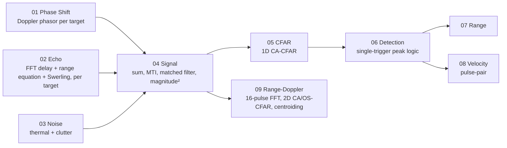
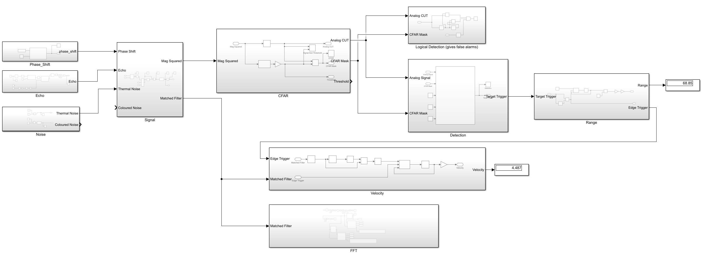

# Pulsed Radar Signal Processing Chain (Simulink)

A pulse-Doppler radar receiver modelled from first principles in Simulink, for any number of simultaneous targets (three in the reference scenario). The echo of each target is delayed in the frequency domain and its amplitude comes from the radar range equation with an independent Swerling I fluctuation; the noise comes from a kTBF receiver budget. The receive chain separates the targets through MTI cancellation, matched filtering, CA-CFAR detection, range and pulse-pair velocity extraction, and a 16-pulse range–Doppler map with 2D CFAR (cell-averaging and order-statistic versions) and centroiding that reports one range and velocity per target.

Every subsystem of the model has its own README, numbered in signal-path order. When you open a block in Simulink, the matching folder explains what is inside it, why it is there, and how it was verified.

---

## Signal chain




*Top level of `Pulse_Radar.slx` with three targets (`target_velocity = [2 3 5]`). The top-level blocks are the same as in the single-target model, but the Echo and FFT subsystems have changed inside; see [02](subsystems/02-echo/README.md) and [09](subsystems/09-range-doppler/README.md). The `Coloured Noise` output is deliberately left unconnected; see [03 Noise](subsystems/03-noise/README.md).*

---

## How to run

1. Open MATLAB in this folder.
2. Run `init` to load every parameter into the workspace. The targets are set by the three equal-length arrays `range`, `target_velocity` and `target_rcs` (set an RCS to 0 to switch a target off).
3. Open `Pulse_Radar.slx` and press **Run**. Stop time is one CPI, `N_cpi × PRI = 16 ms`.
4. Outputs: the range–Doppler Matrix Viewers and `out.cfar_matrix` (CA-CFAR detection map); the target lists `target_param` (CA-CFAR) and `target_param_os` (OS-CFAR) with their headline `range_log`, `vel_log` and `n_targets_log` Displays in the FFT subsystem; and the 1D Range and Velocity displays, which were built for a single return and hold the most recent trigger.

The first CPI frame of the 2D path is a startup transient (the buffer has not yet filled) and is all zeros. Use frame 2 onward. Run `init` again before any test script, because the scripts read the target arrays and constants from the workspace.

**Requirements:** MATLAB and Simulink R2026a, DSP System Toolbox (Buffer, FFT, Matrix Viewer, Array Plot). The offline `centroid_2d.m` script also needs the Image Processing Toolbox (`bwconncomp`); the `centroid_2d` block inside the model uses no toolbox call.

---

## System parameters

### Inputs (set in `init.m`)

| Parameter | Symbol | Value |
|---|---|---|
| Carrier frequency | $f_c$ | 10 GHz (λ = 3 cm) |
| Peak transmit power | $P_t$ | 100 kW |
| Antenna gain | $G$ | 35 dB |
| System losses | $L$ | 2 dB |
| Receiver noise figure | $F$ | 3 dB |
| Pulse width | $\tau_p$ | 100 µs (100 samples) |
| Pulse repetition interval | PRI | 1 ms (1000 samples) |
| Sample time | $T_s$ | 1 µs |
| Pulses per CPI | $N_{cpi}$ | 16 |
| Target ranges | $R$ | `[20 40 70]` km |
| Target radial velocities | $v$ | `[2 3 4]` m/s |
| Target RCS | $\sigma$ | `[1 1 1]` m², the mean of an independent Swerling I draw per target |

The screenshots and test results in this documentation use `target_velocity = [2 3 4]`. The `init.m` saved most recently has `[2 3 5]`. The earlier single-target studies used one target at 20 km and 200 m/s.

### Derived quantities

| Quantity | Formula | Value |
|---|---|---|
| Range bin | $cT_s/2$ | 150 m |
| Range resolution | $c\tau_p/2$ | 15 km |
| Blind range | $c\tau_p/2$ | 15 km |
| Max unambiguous range | $c\cdot\text{PRI}/2$ | 150 km |
| Doppler shift | $f_d = 2v/\lambda$ | 133, 200, 267 Hz (13.33 kHz for the earlier 200 m/s target) |
| Max unambiguous velocity | $\lambda/(4\,\text{PRI})$ | ±7.5 m/s |
| Velocity resolution | $\lambda/(2N_{cpi}\,\text{PRI})$ | 0.94 m/s |
| Received power, mean RCS | radar range equation | 1.8 × 10⁻¹² W (−87.5 dBm), 1.1 × 10⁻¹³ W (−99.5 dBm), 1.2 × 10⁻¹⁴ W (−109.2 dBm) |
| Noise power | $k_B T_0 B F$ | ≈ 8.0 × 10⁻¹⁵ W (−111 dBm) |
| SNR per sample | $P_r/P_n$ | ≈ 23.5, 11.5 and 1.7 dB |
| Matched-filter gain (Hamming) | $(\sum h)^2/\sum h^2$ | 18.6 dB (20 dB for an unweighted filter) |
| SNR after matched filter | | ≈ 42.1, 30.1 and 20.4 dB (slow targets, mean RCS) |

The SNR figures are computed from the formulas above, not measured.

---

## Subsystems

| # | Subsystem | What it does |
|---|---|---|
| 01 | [Phase Shift](subsystems/01-phase-shift/README.md) | Applies each target's Doppler phase rotation |
| 02 | [Echo](subsystems/02-echo/README.md) | Delayed, attenuated copy of the transmit pulse for every target, with the delay applied in the frequency domain |
| 03 | [Noise](subsystems/03-noise/README.md) | Thermal noise and FIR-coloured clutter |
| 04 | [Signal](subsystems/04-signal/README.md) | Sum of the targets, noise, MTI canceller, matched filter, square-law detector |
| 05 | [CFAR](subsystems/05-cfar/README.md) | 1D cell-averaging CFAR threshold |
| 06 | [Detection](subsystems/06-detection/README.md) | One clean trigger per return |
| 07 | [Range](subsystems/07-range/README.md) | Range from trigger index with pipeline-delay compensation |
| 08 | [Velocity](subsystems/08-velocity/README.md) | Pulse-pair velocity estimate |
| 09 | [Range-Doppler](subsystems/09-range-doppler/README.md) | 16-pulse FFT map, 2D CA-CFAR and OS-CFAR, centroiding into one report per target |

Supporting studies: [analysis/](analysis/README.md) (Doppler mismatch velocity sweep, Monte Carlo detection, CA-CFAR versus OS-CFAR multi-target tests, repeatability).

---

## Results

| Quantity | True | Expected from design | Measured |
|---|---|---|---|
| Range, three targets | 20 / 40 / 70 km | 133 / 267 / 467 samples × 150 m = 19.95 / 40.05 / 70.05 km | 19.95 / 40.05 / 70.05 km (both CFARs, one frame) |
| Velocity, three targets | 2 / 3 / 4 m/s | inside ±7.5 m/s, no aliasing | OS-CFAR 2.017 / 2.999 / 4.021 m/s; CA-CFAR 1.967 / 3.049 / 4.014 m/s (one frame) |
| Range–Doppler peaks, three targets | | rows 233 / 367 / 567, Doppler columns 3.13 / 4.20 / 5.27 | blobs at rows ≈ 230 / 370 / 570, columns 3 / 4 / 5–6 |
| All three targets found together | | | 50 trials: CA-CFAR 10/50, OS-CFAR 46/50 (see [analysis](analysis/README.md#c-ca-cfar-versus-os-cfar-multi-target-tests)) |
| Range (single target, earlier model) | 20.00 km | 133 samples × 150 m = 19.95 km | 19.95 km |
| Velocity (single target, earlier model) | 200 m/s | aliased to 200 mod 15 = 5.0 m/s | 5.031 m/s |
| Range–Doppler peak (single target) | | row 233, Doppler bin 5.33 | row ≈ 232, columns 6–7 |
| Probability of detection (single target) | | | 100 % (100 / 100 trials; one SNR, far above threshold, see [analysis](analysis/README.md)) |

---

## Key findings

1. **Velocity aliasing.** With a 1 ms PRI at X-band, the unambiguous velocity is only ±7.5 m/s. A 200 m/s target folds to 5 m/s, which the model reports correctly (single-target study). The three-target scenario stays inside ±7.5 m/s. See [08 Velocity](subsystems/08-velocity/README.md).
2. **Intrapulse Doppler mismatch loss.** The echo phase turns 1.33 times during one 100 µs pulse at 200 m/s, so the matched filter partly cancels itself. Relative to 5 m/s the peak power falls by 9.2 dB with the Hamming-weighted filter in the model (12.4 dB for an unweighted one). See [analysis](analysis/README.md).
3. **CFAR gives detection regions, not points.** The matched-filter response is up to ~200 samples wide and the windowed Doppler response 2–4 bins wide, so CFAR correctly flags a block of cells. `centroid_2d` groups the cells into clusters and reports one target per cluster, with range from the peak and velocity from the power-weighted centroid. See [09 Range-Doppler](subsystems/09-range-doppler/README.md).
4. **Hamming range weighting.** A Hamming-weighted matched filter lowers range sidelobes and is more Doppler tolerant, at 1.4 dB of SNR. Earlier it mismatched the 1D CFAR tuning and broke range extraction, which is written up in [07 Range](subsystems/07-range/README.md); the model now uses it. See [04 Signal](subsystems/04-signal/README.md).
5. **A strong target masks a weaker neighbour in cell-averaging CFAR.** With targets at 20, 40 and 70 km, CA-CFAR detects the middle one in 10 of 50 runs; OS-CFAR detects it in 50 of 50 and produces far fewer false clusters (58 against 5 over 110 trials in four test cases). See [analysis](analysis/README.md#c-ca-cfar-versus-os-cfar-multi-target-tests).
6. **Neither CFAR separates targets in the same range cell.** A weak target two Doppler bins from a strong one at the same range is not reported separately by either CFAR.

## Limitations

- Unmodulated 100 µs pulse gives 15 km range resolution and a 15 km blind range.
- Single CPI, no clutter map across CPIs. The 1D range and velocity blocks handle one return; use the 2D chain for several targets.
- The Hamming-weighted matched filter is more Doppler tolerant than an unweighted one but still loses 9 dB at 200 m/s.
- ±7.5 m/s unambiguous velocity; fast targets alias.
- The coloured-noise (clutter) source was built and simulated on its own and is not part of the signal path, so the end-to-end results use thermal noise only.
- Two targets in the same range cell at similar velocities merge into one cluster.
- The OS-CFAR threshold factor is conservative, and the false-alarm probability of neither CFAR has been validated empirically.

## Future work

- Alpha-beta, then Kalman tracking
- LFM chirp waveform for range resolution and Doppler tolerance
- Staggered PRF for velocity unfolding
- Monte Carlo Pd–SNR curves against the Swerling curves, and an empirical false-alarm check
- Separating targets in the same range cell
- Real-time budget analysis for MCU / FPGA implementation
- Micro-Doppler classification

---

## Repository layout

```
.
├── README.md              ← this file
├── Pulse_Radar.slx
├── init.m                 parameters: targets, RF, CFAR, windows
├── os_cfar_test.m         CA-CFAR versus OS-CFAR over N seeds
├── centroid_test.m        repeatability of the strongest-cluster report
├── centroid_2d.m          offline clustering script (the model uses the block); its header comment says centroid_test.m
├── velocity_test.m        Doppler mismatch sweep and illustrations (written for the single-target model)
├── run_monte_carlo.m      single-target detection Monte Carlo (checks pixel 232, 6 only)
├── multi_target_test.m    earlier CA-only multi-target Monte Carlo (assumes every target is on)
├── maskInitialization.m   mask code, apparently from an earlier per-target subsystem
├── figures/
├── subsystems/
│   ├── 01-phase-shift/    README.md + figures/
│   ├── ...
│   └── 09-range-doppler/
└── analysis/              velocity sweep, Monte Carlo, CFAR tests
```
