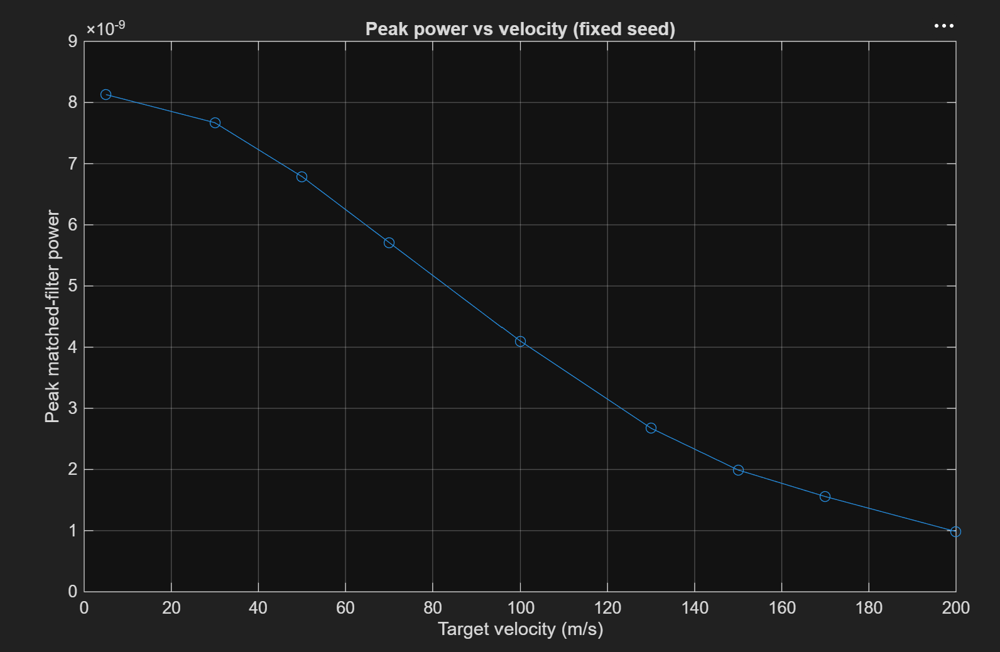
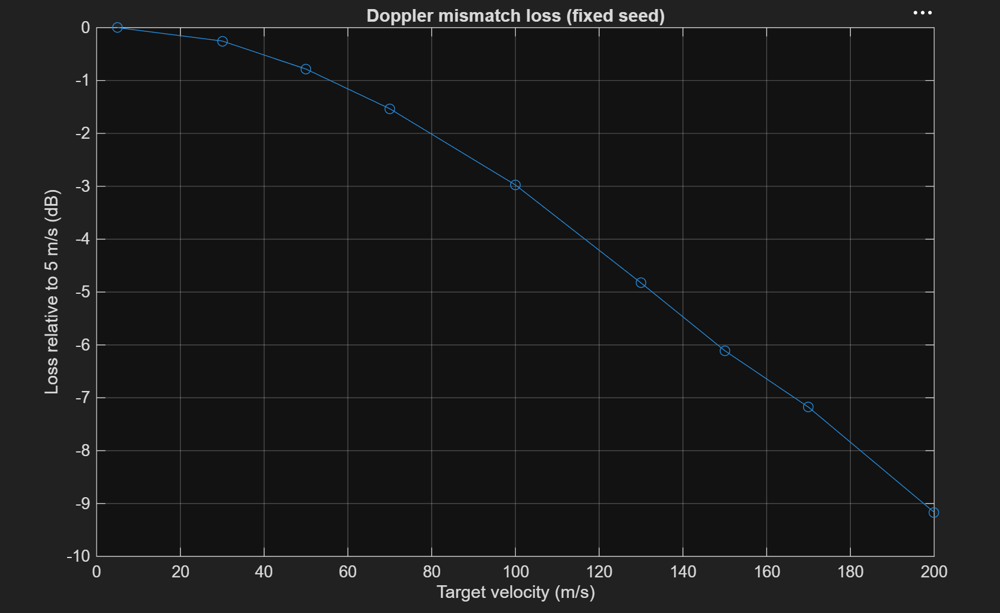
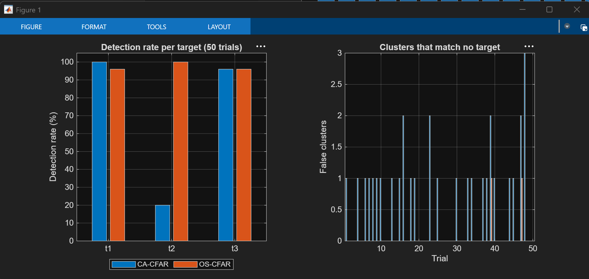
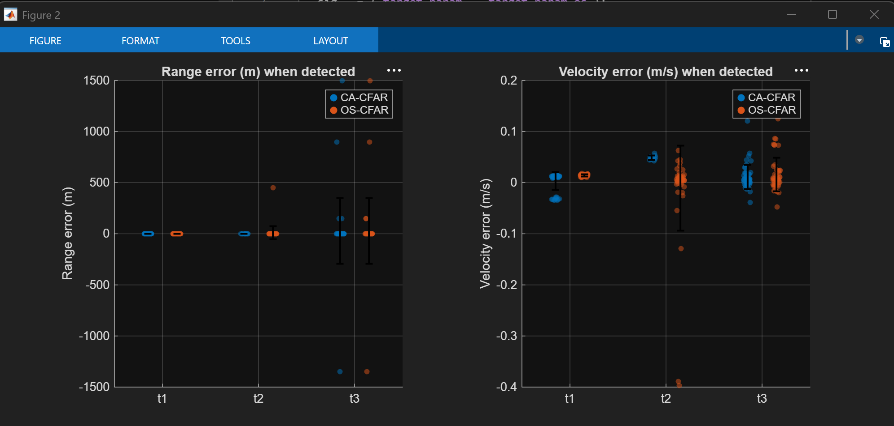
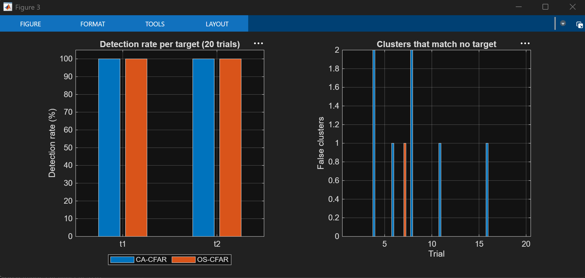
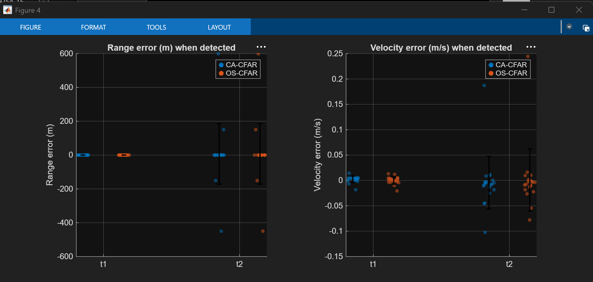
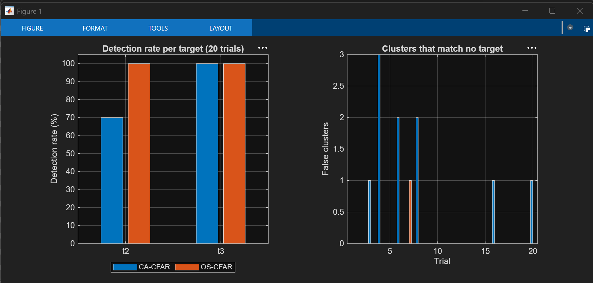
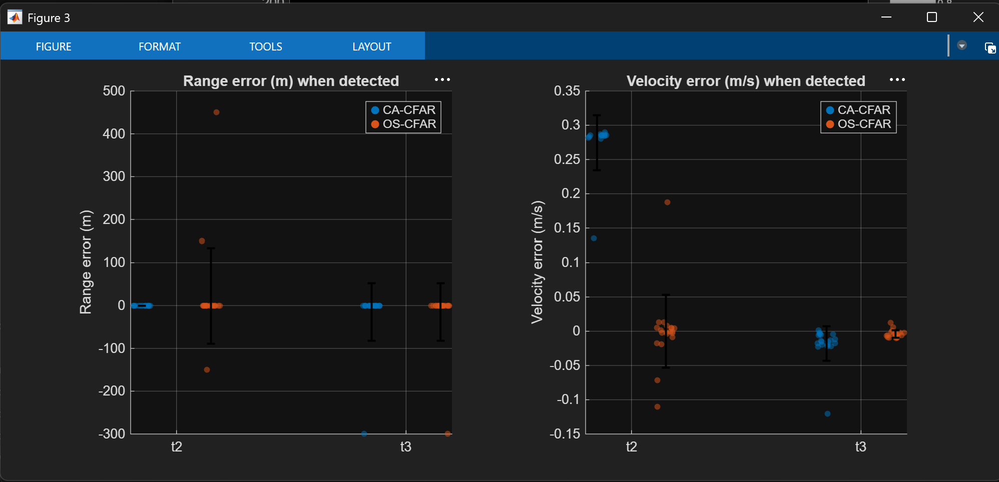
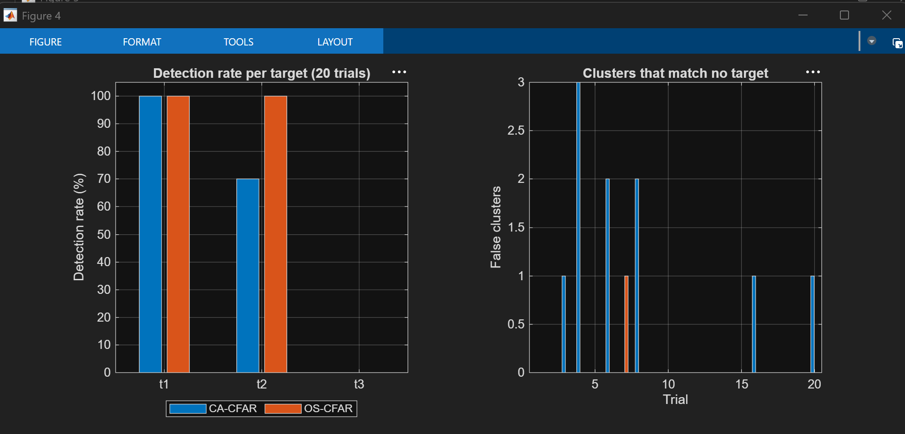
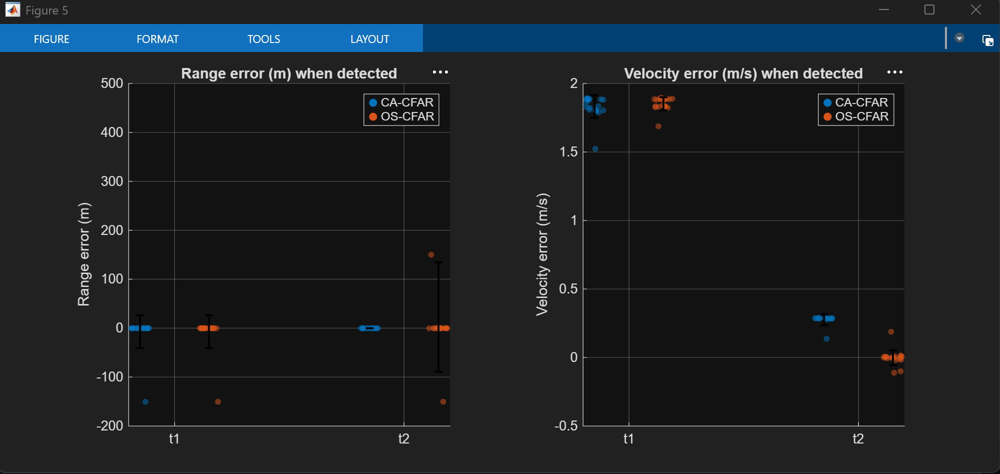

# Analysis

Supporting studies that characterise the model rather than add to it.

- [A. Doppler mismatch loss vs velocity](#a-doppler-mismatch-loss-vs-velocity)
- [B. Monte Carlo detection probability](#b-monte-carlo-detection-probability)
- [C. CA-CFAR versus OS-CFAR multi-target tests](#c-ca-cfar-versus-os-cfar-multi-target-tests)
- [D. Repeatability of the strongest-cluster report](#d-repeatability-of-the-strongest-cluster-report)

Sections A and B were run with the earlier **single-target** model (one Echo channel). Sections C and D use the current three-target model.

---

## A. Doppler mismatch loss vs velocity

*Single-target model. The loss comes from the matched filter and the target's own Doppler, so it applies unchanged to each target of the multi-target model; only the absolute levels differ.*

> **Script status.** `velocity_test.m` is saved as it was for this run. It reads samples 1–1000 of `mf_magsq` as the first pulse, but in the current model the Echo arrives one PRI late, so samples 1–1000 are the empty first PRI ([02 Echo](../subsystems/02-echo/README.md#latency-the-echo-arrives-one-pri-late)). It also sets a single `target_velocity` instead of one value per target. The script would need adapting before the sweep is rerun on the multi-target model.

### Question

The matched filter assumes the echo has constant phase across the pulse. How much peak power is lost as the target speeds up and its phase rotates within the pulse?

### Predictor: turns per pulse

$$ \text{turns per pulse} = f_d\,\tau_p = \frac{2v\,\tau_p}{\lambda} = v \times 0.00667 $$


*The matched filter sums the pulse's samples as arrows tip to tail. The more the phase turns across the pulse, the shorter the sum (red): about 100 at 0.03 turns, about 0 at exactly 1 turn, about 21 at 1.33 turns. The code is in [08 Velocity](../subsystems/08-velocity/README.md).*

### Method

Sweep the target velocity with a **fixed seed** and the RCS held at its mean (the Echo's Uniform Random Number block set to min = max = `exp(-1)`, so $-\ln U = 1$ and $\sigma = 1$ m² on every run). Velocity is then the only thing that changes. **This is a temporary change made only for this calculation:** the Swerling fluctuation is switched off by making the block's minimum and maximum equal, and it is restored (minimum 0.0001, maximum 1) for normal runs and the Monte Carlo. In the multi-target model the same bypass is `exp(-1)*ones(1, numel(range))` for both fields. Record the peak of the matched-filter power $|y|^2$ over the first pulse, which has no MTI cancellation yet.

```matlab
run('init.m');

velocities = [5 30 50 70 100 130 150 170 200];
peak_vals = zeros(size(velocities));

for i = 1:length(velocities)
    target_velocity = velocities(i);
    fd = (2 * target_velocity) / lambda;   % recompute, since init.m sets this from target_velocity
    current_seed = 12345;                  % FIX the seed so noise doesn't confound the comparison
    out = sim('Pulse_Radar', 'ReturnWorkspaceOutputs', 'on');

    mf = squeeze(out.logsout.getElement('mf_magsq').Values.Data(1:1000));  % first pulse, already |y|^2
    peak_vals(i) = max(abs(mf));           % no second square: mf_magsq is already power
end

loss_dB = 10*log10(peak_vals / peak_vals(1));   % loss relative to 5 m/s
fprintf('\n  v (m/s)    peak power      loss (dB)\n');
fprintf('  %6d    %.4e    %7.2f\n', [velocities; peak_vals; loss_dB]);
```

### Results

The matched filter in this run was the **Hamming-weighted** `range_window`. The last column is a computation, not a measurement: the best overlap of a rotating phasor with an all-ones (rectangular) filter.

| v (m/s) | Turns per pulse | Peak power | Loss vs 5 m/s, measured | Loss, rectangular filter (computed) |
|---|---|---|---|---|
| 5 | 0.03 | 8.130 × 10⁻⁹ | 0 dB | 0 dB |
| 30 | 0.20 | 7.670 × 10⁻⁹ | −0.25 dB | −0.56 dB |
| 50 | 0.33 | 6.789 × 10⁻⁹ | −0.78 dB | −1.63 dB |
| 70 | 0.47 | 5.712 × 10⁻⁹ | −1.53 dB | −3.35 dB |
| 100 | 0.67 | 4.099 × 10⁻⁹ | −2.97 dB | −6.40 dB |
| 130 | 0.87 | 2.675 × 10⁻⁹ | −4.83 dB | −8.68 dB |
| 150 | 1.00 | 1.992 × 10⁻⁹ | −6.11 dB | −9.93 dB |
| 170 | 1.13 | 1.557 × 10⁻⁹ | −7.18 dB | −11.01 dB |
| 200 | 1.33 | 0.985 × 10⁻⁹ | −9.17 dB | −12.43 dB |




**Checks that the numbers are right.** Computing the same sweep for a Hamming-weighted filter gives −0.27, −0.75, −1.50, −3.02, −4.83, −6.08, −7.35 and −9.21 dB, within 0.2 dB of every measured point. The absolute 5 m/s level also agrees: an unfaded echo with `L = 1` ($2.83\times10^{-8}$) times $(\sum w)^2/N^2 = 0.287$ gives $8.13\times10^{-9}$, the measured value. So the sweep is measuring what it should.

This run was taken before `radar_const` was moved below the 2 dB loss in `init.m` (see [02 Echo](../subsystems/02-echo/README.md)). With the loss applied, every absolute peak above is 2 dB lower (the 5 m/s peak becomes about $5.1\times10^{-9}$). The loss columns are relative, so they do not change.

### Interpretation

- Loss starts immediately and grows smoothly. There is no velocity at which the filter suddenly breaks. The −3 dB point is at about 100 m/s for the Hamming filter and about 66 m/s for the rectangular one.
- The **shape** of the range response stays a single peak up to roughly half a turn per pulse (≈ 70 m/s) and splits into lobes beyond one turn (the 200 m/s case), even though the **height** is already falling well before that.
- **No null at one full turn (150 m/s).** The full-overlap sum is zero there, but the peak is searched over all lags. At partial overlap the samples cover only part of a turn and do not cancel, so the maximum never reaches zero.
- **The Hamming filter is more Doppler tolerant.** At 200 m/s it loses 9.2 dB where the rectangular filter loses 12.4 dB, because it weights the middle of the pulse, where less phase has accumulated. It costs 5.4 dB of peak power, but it also cuts the noise by 4.0 dB, so its SNR cost is 1.4 dB for a slow target. At 200 m/s it is about 1.8 dB ahead of the rectangular filter.
- Against the documented 43.5 dB (rectangular, stationary), the 200 m/s target is still ≈ 43.5 − 12.4 ≈ 31 dB above noise with the rectangular filter, or ≈ 43.5 − 1.4 − 9.2 ≈ 33 dB with the Hamming one: detectable, with most of the margin kept.

> **Earlier version of this sweep.** An earlier run applied `abs(mf).^2` to a signal that is already $|y|^2$ (`mf_magsq` is tagged on the output of the $|u|^2$ block, see [04 Signal](../subsystems/04-signal/README.md)), so its dB figures were doubled: −24 dB at 200 m/s. That run also used the rectangular filter. Halved, its figures (−12.1 dB at 200 m/s) agree with the rectangular column above to within 0.46 dB at every speed (the largest difference is at 170 m/s: −10.55 against −11.01 dB).

### Mitigations

A shorter pulse, a Doppler-tolerant waveform (LFM chirp), or a bank of Doppler-shifted matched filters.

---

## B. Monte Carlo detection probability

*Single-target model (one target at 200 m/s, aliased to 5 m/s), with the earlier `cfar_2d` (`Gr = 200`, `Gd = 2`, no padding).*

> **Script status.** `run_monte_carlo.m` is still this single-target version: it checks pixel (232, 6) only. None of the current targets sits there: with `init.m` as saved they are at rows 233, 367 and 567 and Doppler columns 3.13, 4.20 and 6.33 (see [09](../subsystems/09-range-doppler/README.md#expected-target-positions)). For the multi-target model use `os_cfar_test.m` (section C).

### Method

Run the model repeatedly with a new random seed each time (so a new Swerling I RCS draw and new noise each time) and count how often the 2D CFAR flags the known target position, row 232 and Doppler column 6, in the last frame of the detection map.

```matlab
num_trials = 100;
successful_hits = 0;

run('init.m');                                   % loads the static physics (radar_const) once

for trial = 1:num_trials
    % 1. Inject a brand new random seed into the MATLAB workspace.
    %    Simulink pulls this variable into the Uniform Random Number block.
    current_seed = randi(100000);

    % 2. Run the model silently
    out = sim('Pulse_Radar', 'ReturnWorkspaceOutputs', 'on');

    % 3. Take the final 1000x16 binary detection matrix
    detection_map = out.cfar_matrix(:, :, end);

    % 4. Check the known target coordinate [Y = 232, X = 6]
    if detection_map(232, 6) == 1
        successful_hits = successful_hits + 1;
    end

    if mod(trial, 10) == 0
        fprintf('Completed %d / %d trials...\n', trial, num_trials);
    end
end

Pd = successful_hits / num_trials;
fprintf('\n--- VALIDATION RESULTS ---\n');
fprintf('Probability of Detection (Pd): %.2f%%\n', Pd * 100);
```

### Results

Output of the script above. It was run before `radar_const` was moved below the 2 dB loss in `init.m`, so the echo was about 2 dB stronger than documented:

```
Completed 100 / 100 trials...
--- VALIDATION RESULTS ---
Probability of Detection (Pd): 100.00%
```

**Is 100 % believable?** Yes at this operating point, but it is a weak test. The target is nowhere near the threshold:
- The 2D CFAR threshold is about 13.9 × the local average (11.4 dB, from $\alpha$ with 1026 training cells for the `Gr = 200`, `Gd = 2` CFAR used in this run; the current `cfar_2d` has $\alpha$ = 13.96 with 690 cells).
- The thermal-noise budget alone leaves about 43.5 dB of integrated SNR: 23.5 dB per sample, plus 20 dB matched filter, minus about 12 dB Doppler mismatch at 200 m/s, plus about 12 dB from the 16-pulse FFT (43.1 dB with the computed −12.43 dB mismatch loss). That ignores the clutter.
- The range–Doppler map shows the peak tens of dB above its surroundings, and the 2D CFAR block around it (rows ≈ 185–280, columns 5–8) covers the test pixel with room to spare.
- For a Swerling I target the single-look Pd is $P_{fa}^{1/(1+\mathrm{SNR})}$, about 0.9993 at 43.1 dB. So 100 hits out of 100 is the expected result: roughly 93 % of such runs would show no miss.

**What it does not show:**
- Zero misses in 100 trials only bounds Pd above about 97 % (95 % confidence).
- It is a single SNR. Pd becomes informative only after the SNR is swept down (see the planned extension below), to where the fading RCS sometimes drops the target under the threshold.
- No false alarms are counted. The script checks one pixel and never looks at the rest of the map, so $P_{fa} = 10^{-6}$ is still unvalidated.
- A new `current_seed` changes everything random. The script's comment mentions only the RCS draw, but the block parameters show that the thermal noise blocks use `current_seed` and `current_seed + 1`, the clutter blocks `+ 2` and `+ 3`, and the Echo `current_seed + 100*(1:N)` ([03 Noise](../subsystems/03-noise/README.md), [02 Echo](../subsystems/02-echo/README.md)). So every trial has fresh noise and a fresh RCS. (The clutter blocks are not in the signal path, see [03 Noise](../subsystems/03-noise/README.md).)

### Planned extension

Not done yet:

1. **False alarms per run.** Count every detection outside a tolerance window around the target (for example row 232 ± 5, column 6 ± 1) and use more trials, since 500 trials give a standard error of about ±1.3 % at Pd = 0.9. Sketch of the change to the loop above:

```matlab
r = max(1, 232-5) : min(size(det,1), 232+5);
d = max(1, 6-1)   : min(size(det,2), 6+1);
region = det(r, d);
hits = hits + any(region(:));
false_alarms = false_alarms + (sum(det(:)) - sum(region(:)));
```

2. **SNR sweep.** Sweep SNR and plot empirical Pd against the analytical Swerling 0 / I curves for $P_{fa} = 10^{-6}$. Agreement validates the detector end to end, and it is the test that makes Pd informative, because this is where the fading RCS starts to drop the target under the threshold.

---

## C. CA-CFAR versus OS-CFAR multi-target tests

### Question

With several targets in one range–Doppler map, does the cell-averaging CFAR keep detecting all of them, and does the order-statistic CFAR ([09](../subsystems/09-range-doppler/README.md#os-cfar-order-statistic)) do better?

### Method

`os_cfar_test.m` runs the model for N seeds. Both CFARs read the same `rd_matrix` in each run, so they see identical noise and identical Swerling draws. For each run it reads the last frame of the two logged target lists (`target_param` for CA-CFAR, `target_param_os` for OS-CFAR) and compares them with the targets that are switched on in `init.m`:

- **Expected targets.** Every target with `target_rcs > 0`: expected row `round(2*range/c/Ts) + 100`, expected velocity `target_velocity`. The script reads these from the workspace, so it works for any scenario without editing.
- **Matching.** A cluster counts as target *i* if its peak row is within 10 rows (1.5 km). Clusters are matched one-to-one, closest first. Velocity error is taken modulo 15 m/s because velocity is only defined modulo $\lambda/(2\,\text{PRI})$.
- **Scores.** Per target: runs found, mean ± standard deviation of range error and velocity error when found. Per run: **false clusters**, meaning clusters not matched to any target (either a noise detection or a fragment of a real target's mask that split off; the test does not tell the two apart).
- **Seeds.** `rng(1)` then `randi(100000, N, 1)`, so a run is repeatable and identical for both CFARs. Because every target fades (Swerling I), a detection rate below 100 % includes runs where the target faded below the threshold.

`init` must be run immediately before the script, because the script reads `c`, `Ts`, `range`, `target_velocity` and `target_rcs` from the workspace.

### Case 1: three targets, equal RCS (50 trials)

`range = [20e3 40e3 70e3]`, `target_velocity = [2 3 4]`, `target_rcs = [1 1 1]`.

| Target | Row, velocity | CA found | OS found | CA range error (m) | OS range error (m) | CA velocity error (m/s) | OS velocity error (m/s) |
|---|---|---|---|---|---|---|---|
| t1 | 233, 2 m/s | 50/50 | 48/50 | 0.0 ± 0.0 | 0.0 ± 0.0 | +0.003 ± 0.018 | +0.014 ± 0.002 |
| t2 | 367, 3 m/s | **10/50** | **50/50** | 0.0 ± 0.0 | +9.0 ± 63.6 | +0.049 ± 0.004 | −0.010 ± 0.083 |
| t3 | 567, 4 m/s | 48/50 | 48/50 | +28.1 ± 322.5 | +28.1 ± 322.5 | +0.011 ± 0.024 | +0.016 ± 0.033 |

False clusters in 50 trials: **CA 31, OS 2**. All three found together: **CA 10/50, OS 46/50**.


*Case 1. Left: detection rate per target. CA-CFAR (blue) finds target 2 in only 20 % of runs, OS-CFAR (orange) in all of them. Right: false clusters per trial.*


*Case 1. Range and velocity error when detected. Velocity errors are within about 0.1 m/s. Range errors are zero (the 150 m bin) except for a few outliers of 900–1500 m for the weak target 3, where the response is close to the noise and the peak cell moves by 6–10 rows.*

**Why CA-CFAR misses the middle target.** Each cell's noise estimate comes from strips of training cells 101–116 rows either side of it. For target 2 (row 367) those strips are rows 251–266 and 468–483. The lower strip is only 18–33 rows from target 1's peak (row 233), well inside target 1's strong response, and target 1 is on average 12 dB stronger than target 2 because it is at half the range. The cell-averaging estimate is dominated by target 1's energy, the threshold rises above target 2, and target 2 is masked.

The reverse does not happen. Target 1's own upper strip (rows 334–349) also lies on target 2's response, but target 2 is much weaker, so it barely lifts target 1's threshold. Target 3, the weakest, has its strips at rows 451–466 and 668–683, which are 84–99 rows from target 2's peak and only on its far skirt, so it is barely contaminated and CA-CFAR finds it. The masking therefore depends on relative strength as well as spacing. OS-CFAR sorts the training cells and takes the 75th percentile, which ignores the strongest quarter of them, so a strong neighbour that covers only part of the ring does not set the threshold.

OS-CFAR missed target 1 in two runs where CA-CFAR did not. That is consistent with the OS threshold being 1.4 dB higher than the exact order-statistic value ([09](../subsystems/09-range-doppler/README.md#os-cfar-order-statistic)); I have not confirmed it.

### Case 2: two targets, well separated (20 trials)

`range = [40000 56000 70000]`, `target_velocity = [5 -3 4]`, `target_rcs = [1 1 0]` (target 3 switched off).

| Target | Row, velocity | CA found | OS found | CA range error (m) | OS range error (m) | CA velocity error (m/s) | OS velocity error (m/s) |
|---|---|---|---|---|---|---|---|
| t1 | 367, +5 m/s | 20/20 | 20/20 | 0.0 ± 0.0 | 0.0 ± 0.0 | +0.002 ± 0.006 | 0.000 ± 0.007 |
| t2 | 473, −3 m/s | 20/20 | 20/20 | +7.5 ± 178.6 | +7.5 ± 178.6 | −0.004 ± 0.052 | +0.001 ± 0.061 |

False clusters in 20 trials: **CA 7, OS 1**. All found together: **CA 20/20, OS 20/20**.


*Case 2. Both CFARs find both targets in every run. CA-CFAR produces more false clusters.*


*Case 2. Errors when detected, for both CFARs.*

With the targets 106 rows and 8 m/s apart, neither masks the other, so the two CFARs detect equally; the difference is in the false clusters.

### Case 3: two strong targets, one near the velocity limit (20 trials)

`range = [0 56e3 40e3]`, `target_velocity = [0 -3 6.9]`, `target_rcs = [0 2 2]` (target 1 switched off; the zero range is floored to 1 m by `init.m`). Target 3 at +6.9 m/s is close to the +7.5 m/s edge of the Doppler axis.

| Target | Row, velocity | CA found | OS found | CA range error (m) | OS range error (m) | CA velocity error (m/s) | OS velocity error (m/s) |
|---|---|---|---|---|---|---|---|
| t2 | 473, −3 m/s | **14/20** | **20/20** | 0.0 ± 0.0 | +22.5 ± 111.8 | **+0.274 ± 0.040** | 0.000 ± 0.053 |
| t3 | 367, +6.9 m/s | 20/20 | 20/20 | −15.0 ± 67.1 | −15.0 ± 67.1 | −0.018 ± 0.025 | −0.004 ± 0.006 |

False clusters in 20 trials: **CA 10, OS 1**. All found together: **CA 14/20, OS 20/20**.


*Case 3. CA-CFAR misses target 2 in 30 % of runs; OS-CFAR finds both targets in every run.*


*Case 3. When CA-CFAR does detect target 2, its velocity estimate is biased by +0.27 m/s with a small spread, while OS-CFAR is unbiased.*

A velocity bias that is constant from run to run is what a mask cut off on one side would give, since the centroid is pulled towards the part of the mask that survives. I have not investigated this further. Target 3 at +6.9 m/s is detected without trouble by both, so the wrap-around at the Doppler edge works.

### Case 4: a weak target in the same range cell as a strong one (20 trials)

`range = [40e3 56e3 40e3]`, `target_velocity = [5 -3 6.9]`, `target_rcs = [0.01 2 2]`. Targets 1 and 3 are at the same range (row 367) and 1.9 m/s (two Doppler bins) apart, and target 1 has 23 dB less RCS than target 3.

| Target | Row, velocity | CA found | OS found | CA velocity error (m/s) | OS velocity error (m/s) |
|---|---|---|---|---|---|
| t1 | 367, +5 m/s | 20/20 | 20/20 | **+1.832 ± 0.082** | **+1.852 ± 0.048** |
| t2 | 473, −3 m/s | 14/20 | 20/20 | +0.274 ± 0.040 | −0.001 ± 0.056 |
| t3 | 367, +6.9 m/s | **0/20** | **0/20** | – | – |

False clusters in 20 trials: **CA 10, OS 1**. All found together: **CA 0/20, OS 0/20**.


*Case 4. Target 1 appears in every run and target 3 in none, for both CFARs.*


*Case 4. Target 1's velocity error is about +1.85 m/s for both CFARs.*

**Read this case carefully.** The 20/20 for target 1 and 0/20 for target 3 are a bookkeeping result, not a physical one. Only one cluster exists at row 367 in each run. When the cluster is equally close to two targets the matching function gives it to the first one in the list, target 1. The velocity error of about +1.85 m/s shows what that cluster really is: it reports about 6.85 m/s, which is the **strong** target 3 (6.9 m/s), not target 1 (5 m/s). So the strong target is detected in every run, and the weak target 1 is never reported separately. Either its response is below the CFAR threshold in the skirt of the strong one, or it is merged into the same cluster; the test cannot tell which. Neither CFAR separates two targets in the same range cell this close in Doppler. The 0/20 "all found together" is therefore expected and is not a CFAR failure in the usual sense.

### Summary of the four cases

| Case | Active targets | Trials | All found together, CA | All found together, OS | False clusters, CA | False clusters, OS |
|---|---|---|---|---|---|---|
| 1 | 3 (20, 40, 70 km) | 50 | 10/50 | 46/50 | 31 | 2 |
| 2 | 2 (separated) | 20 | 20/20 | 20/20 | 7 | 1 |
| 3 | 2 (strong) | 20 | 14/20 | 20/20 | 10 | 1 |
| 4 | 3 (two in one cell) | 20 | 0/20 | 0/20 | 10 | 1 |

- **OS-CFAR detected every target that CA-CFAR detected** and recovered the target that CA-CFAR loses when it sits between strong neighbours (cases 1 and 3). The exception is two missed detections of target 1 in case 1.
- **False clusters:** 58 for CA-CFAR against 5 for OS-CFAR over 110 trials.
- **Velocity accuracy** is within about 0.1 m/s for both when a target is detected cleanly, except CA-CFAR's +0.27 m/s bias on the masked-neighbour target in cases 3 and 4.
- **Not solved:** two targets in one range cell at similar velocities (case 4), and deeply faded weak targets (the 48/50 results).
- **Caveats.** The 20 and 50-trial counts have large uncertainty (one run is 5 % or 2 %). The OS-CFAR $\alpha$ is conservative, which trades some detections for fewer false alarms, and the false-alarm probability of neither CFAR has been validated. The clutter source is not part of the signal path ([03 Noise](../subsystems/03-noise/README.md)), so these tests had thermal noise only.

---

## D. Repeatability of the strongest-cluster report

### Method

`centroid_test.m` (despite its name, a repeatability test) runs the model for 20 random seeds and reads three logged signals from the CA-CFAR path, `range_log`, `vel_log` and `n_targets_log`, in the last frame. Those headline numbers describe the **strongest** cluster only. The script's pass criterion (exactly one cluster, at 19.95 km and about 5.03 m/s) was written for the single-target model and cannot be met by a three-target scene, so the run "fails" by design. What it does show:

### Results

| | Result |
|---|---|
| Runs with a detection | 20 of 20 |
| Clusters per run | 3 in 18 runs, 2 in 2 runs (runs 14 and 16) |
| Strongest cluster is target 1 (19.95 km, 2.01 m/s) | 11 runs |
| Strongest cluster is target 2 (40.05 km, 3.03–3.06 m/s) | 9 runs |
| Strongest cluster is target 3 (70 km) | 0 runs |

- **The headline target changes from run to run** because "strongest" means the highest total power, and the Swerling draws decide which of targets 1 and 2 wins. Target 3 is nominally 22 dB weaker than target 1 and never wins. For a multi-target report use the full `targets` table, not the headline.
- **Range is exact** (19.95 and 40.05 km, the 150 m-quantised values) in every run, and velocity is within 0.07 m/s of the true value.
- **Two runs lost one cluster**, which is consistent with a faded target dropping below the CA-CFAR threshold or being masked, as in section C.
