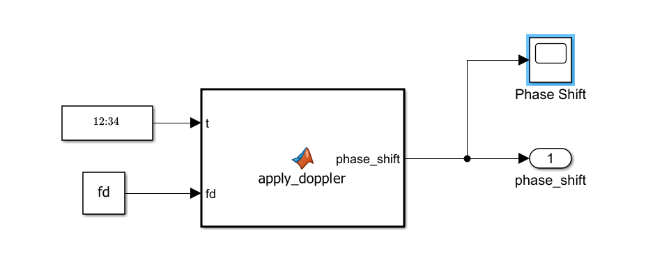
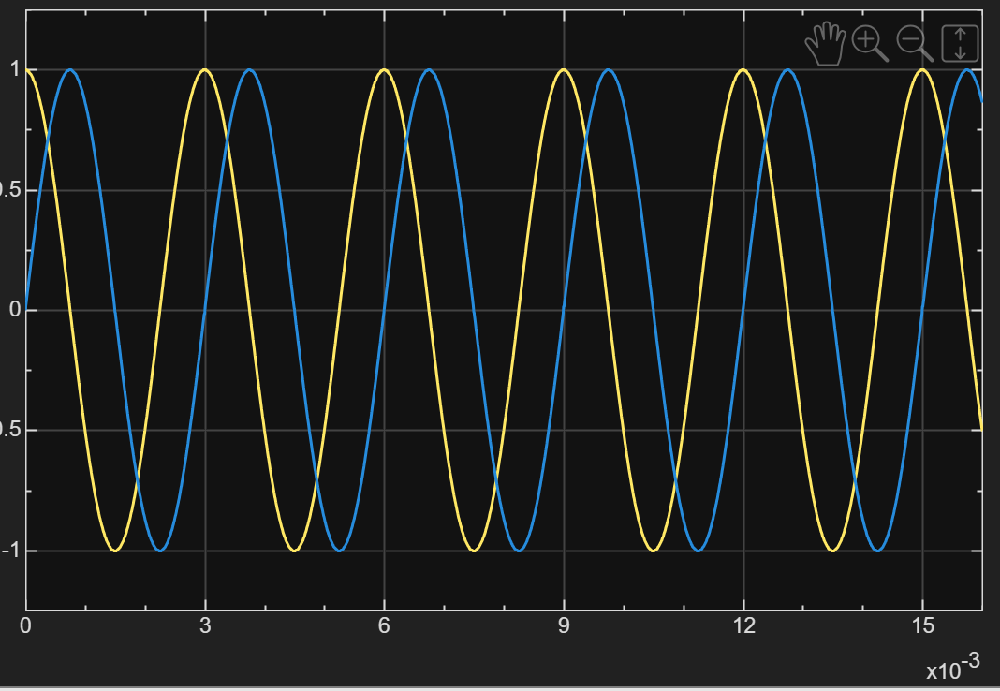
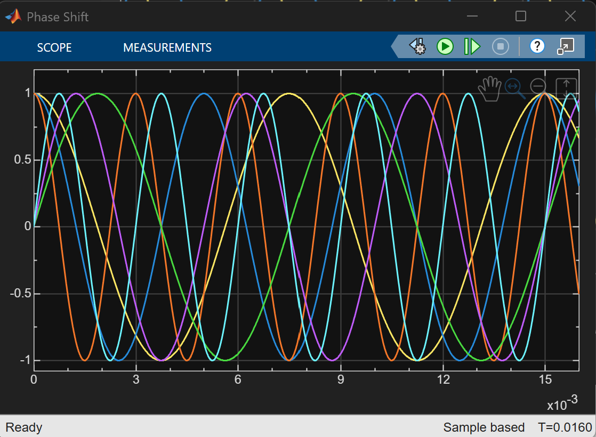

# 01 · Phase Shift (Doppler)

> Generates the rotating phasor that a moving target imprints on its echo.

**Input:** simulation time $t$, Doppler shifts `fd` (one per target, from `init.m`)
**Output:** one complex phasor per target (a vector with `numel(target_velocity)` elements), multiplied with the echo channels in [04 Signal](../04-signal/README.md)



---

## Implementation

```matlab
function phase_shift = apply_doppler(t, fd)
    phase_shift = exp(1j * 2 * pi * fd * t);
end
```

Blocks: a Digital Clock supplies `t` (a scalar), a Constant supplies the vector `fd`, and the MATLAB Function block `apply_doppler` outputs `phase_shift`, which goes to the outport and to a `Phase Shift` scope. A scalar `t` times a vector `fd` gives one phasor per target, so the same block serves any number of targets.

```matlab
% init.m (as currently saved)
target_velocity = [2 3 5];               % m/s, one per target, positive = approaching
fd = (2 * target_velocity) / lambda;     % Doppler shift of each target (Hz)
```

| Parameter | Value |
|---|---|
| `target_velocity` | `[2 3 4]` m/s in the screenshots and tests in this documentation |
| `lambda` | 0.03 m |
| `fd` | `[133.3 200 266.7]` Hz |

> **Note:** the `init.m` saved most recently has `target_velocity = [2 3 5]`, so the third target sits at 333 Hz and Doppler column 6.33 instead of 5.27. The screenshots and test results in this documentation were taken with 4 m/s, except the three-target phase-shift scope and the full-model capture, which used 5 m/s. The earlier single-target studies used 200 m/s (and 5 m/s for the waveform below); see [Two timescales](#two-timescales).

---

## Theory

A target closing at velocity $v$ has range $R(t) = R_0 - vt$, so the round-trip delay changes with time:

$$ \tau(t) = \frac{2R(t)}{c} = \frac{2(R_0 - vt)}{c} $$

After down-conversion, the carrier leaves a phase term $e^{-j2\pi f_c \tau(t)}$ on the baseband echo. Substituting $\tau(t)$:

$$ \phi(t) = -\frac{4\pi f_c R_0}{c} + \frac{4\pi f_c v}{c}\,t $$

The first term is a constant starting angle. The second grows linearly in time, which is a rotating phasor at

$$ f_d = \frac{2 f_c v}{c} = \frac{2v}{\lambda} $$

---

## Two timescales

The same rotation matters on two different time intervals, and each causes a separate effect. The table gives the current three-target scenario and, for contrast, the fast single target (200 m/s) that the earlier studies and the debugging notes in [07](../07-range/README.md) and [08](../08-velocity/README.md) were built around:

| Interval | Targets at 2, 3, 4 m/s | A single target at 200 m/s | Consequence |
|---|---|---|---|
| Within one pulse, $f_d\tau_p$ | 0.013, 0.020, 0.027 turns | 13,333 × 100 µs = **1.33 turns** | At 200 m/s the matched filter partly cancels: mismatch loss ([analysis](../../analysis/README.md)). At 2–4 m/s the loss is negligible |
| Between pulses, $f_d\cdot\text{PRI}$ | 0.133, 0.200, 0.267 turns | 13,333 × 1 ms = **13.33 turns** | All three are inside ±0.5 turn, so nothing aliases. At 200 m/s only the 0.33-turn remainder is observable and the velocity aliases to 5 m/s ([08 Velocity](../08-velocity/README.md)) |

**Modelling choice.** The phasor rotates continuously at sample rate, which is physically faithful. Textbook pulsed-radar models often hold the phase constant within a pulse and step it once per PRI, which is valid when $f_d\tau_p \ll 1$. That condition is violated for the 200 m/s case, so the continuous model was kept deliberately and its consequence measured.

---

## Verification


*Output of the `Phase Shift` scope over one CPI (16 ms): I (yellow, cosine) and Q (blue, sine). There are 5.33 cycles in 16 ms, a period of 3 ms, so this capture is 333 Hz, which is $f_d$ for 5 m/s. It was taken with the earlier single-target model.*


*The same scope with three targets: three cosines (I) and three sines (Q), six traces. The cosines have periods of 7.5, 5.0 and 3.0 ms and the sines peak first at 1.9, 1.25 and 0.75 ms, which are $f_d$ = 133, 200 and 333 Hz, so this capture used `target_velocity = [2 3 5]`, the `init.m` saved most recently. The earlier screenshots and tests used 4 m/s for the third target (267 Hz).*

At 200 m/s ($f_d$ = 13.33 kHz) the same plot would hold 213 cycles in 16 ms. Sampled once per PRI, the 200 m/s phasor lands on exactly the same points as this 333 Hz curve: 13.33 turns and 0.33 turn per PRI look identical, which is the aliasing described in [08 Velocity](../08-velocity/README.md).

---

[Index](../../README.md) · [02 Echo →](../02-echo/README.md)
