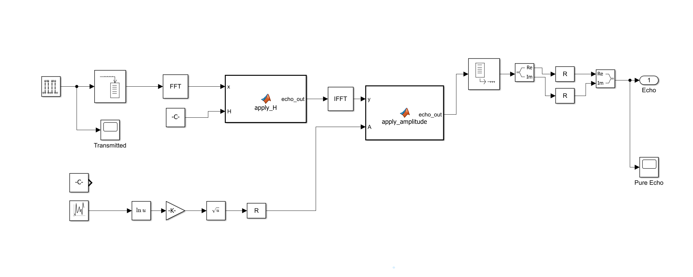
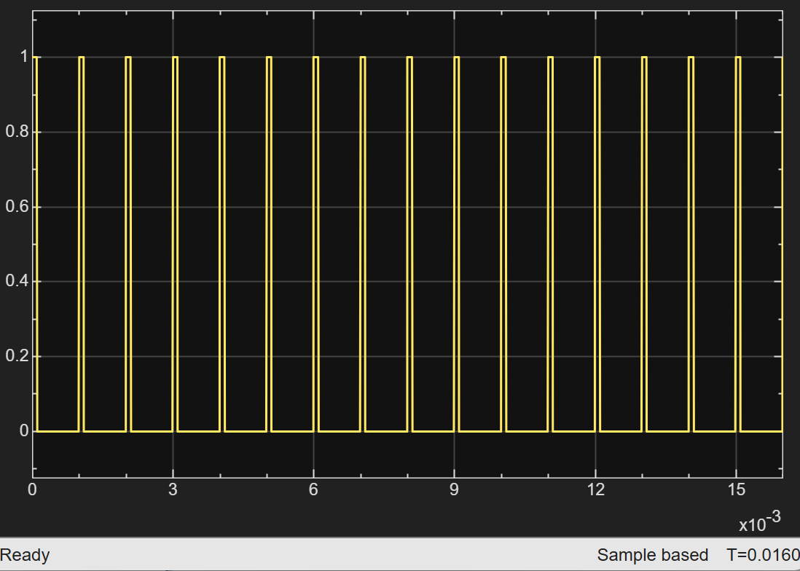
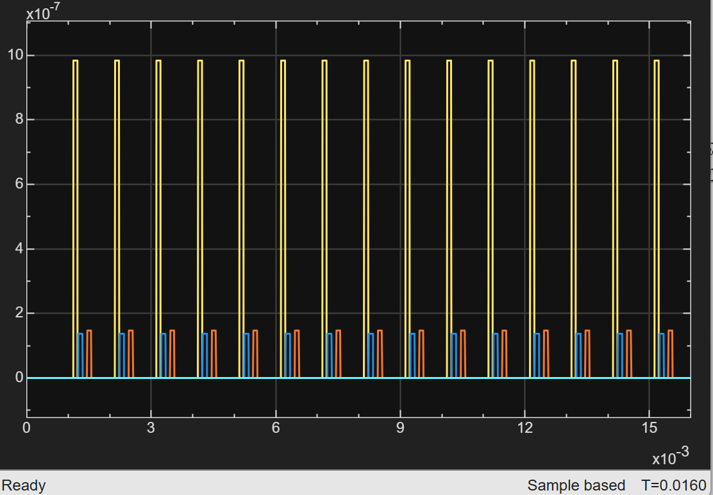

# 02 · Echo

> Produces the target returns: the transmit pulse, delayed per target by its round-trip time (applied in the frequency domain) and scaled per target by the radar range equation and a Swerling I fluctuation.

**Input:** none (pulse train generated internally)
**Output:** one complex echo channel per target (a vector with `numel(range)` elements), multiplied by the Doppler phasors in [04 Signal](../04-signal/README.md)



The number of targets is set by the length of the `range`, `target_velocity` and `target_rcs` arrays in `init.m`. Nothing in this subsystem has to change when a target is added, removed or moved.

---

## How it works

The subsystem has two paths that meet at the `apply_amplitude` block.

**Signal path (delay).**

| # | Block | Parameter | What it does |
|---|---|---|---|
| 1 | Pulse Generator | period `N_PRI`, width `N_tau_p`, sample time `Ts` | 100-sample pulses every 1000 samples; also tapped by the `Transmitted` scope |
| 2 | Buffer | one PRI (`N_PRI` samples) | collects one pulse period into a 1000 × 1 frame |
| 3 | FFT | 1000 points | frequency-domain copy of the pulse period |
| 4 | MATLAB Function `apply_H(x, H)` | `H` = Constant `H_delay` | `x .* H`: multiplies the spectrum by each target's phase ramp, giving a 1000 × N matrix |
| 5 | IFFT | normalised | back to the time domain: column *k* is the pulse delayed by target *k*'s delay |
| 6 | MATLAB Function `apply_amplitude(y, A)` | | `y .* reshape(A, 1, N)`: scales each column by that target's amplitude |
| 7 | Unbuffer, Complex to Real-Imag, Reshape, Real-Imag to Complex | `numel(range)` | turn the frames back into one sample per time step, as an N-wide complex vector |
| 8 | Outport `Echo` | | to [04 Signal](../04-signal/README.md); also tapped by the `Pure Echo` scope |

**Amplitude path (one random draw per target).**

| Block | Parameter | What it does |
|---|---|---|
| Uniform Random Number | min `0.0001*ones(1, numel(range))`, max `ones(size(range))`, seed `current_seed + 100*(1:numel(range))`, sample time `T_stop` | one draw $U_k$ per target per run, held for the whole CPI |
| Math Function $\ln u$ | | $\ln U_k$, always negative |
| Gain `-K-` | `-target_rcs.*radar_const` | $-\sigma_k\,c_k\ln U_k$: exponentially distributed received power with mean $\sigma_k c_k$ |
| Square Root | | power to amplitude |
| Reshape | | sets the vector orientation for `apply_amplitude` |

The `Reshape` blocks only set whether the N-wide signals are rows or columns so that the blocks line up. An unconnected Constant `[exp(-1), exp(-1), exp(-1)]` sits beside the random block; see [Target fluctuation](#target-fluctuation-swerling-i) for what it is for.

### Why the delay is applied in the frequency domain

Delaying a signal by $d$ samples multiplies its DFT by $e^{-j2\pi k d/N}$. The buffer holds exactly one PRI, so $N = N_{PRI} = 1000$, and `init.m` builds one such phase ramp per target:

```matlab
N = N_PRI;
k_idx = (0:N-1)';
H_delay = exp(-1j*2*pi*k_idx*N_delay/N);    % 1000 x N_targets
```

Multiplying the pulse's spectrum by the matrix, then taking the IFFT, gives all the delayed pulses at once: column *k* is the pulse circularly shifted by `N_delay(k)` samples. Two consequences:

- **Wrap-around is built in.** The shift is circular, so a return whose delay plus pulse width exceeds one PRI re-enters at the start of the same PRI. That is how a range beyond the unambiguous range (150 km) shows up in a pulsed radar, and the position check at the end of `init.m` applies the same `mod(N_delay, N_PRI)`.
- **Delays are whole samples.** `N_delay` is rounded, so ranges are quantised to the 150 m bin.

### Latency: the echo arrives one PRI late

The Buffer must collect a whole PRI before it releases anything, so every echo comes out exactly `echo_chain_delay = N_PRI = 1000` samples later than its `N_delay`. The echo of pulse *k* therefore lands in PRI *k + 1*, and **the first PRI contains no echo**. On the `Pure Echo` scope the echoes that should start at 0.13, 0.27 and 0.47 ms start at about 1.1, 1.3 and 1.5 ms.

A delay of exactly one PRI does not change where a return sits *inside* its PRI, so the expected range–Doppler rows ([09](../09-range-doppler/README.md)) and the 1D delay budget ([07](../07-range/README.md)) are unaffected. It does move the first echo into PRI 2, which matters for the MTI start-up ([04](../04-signal/README.md)).

---

## Timing

| Parameter | Formula | Value |
|---|---|---|
| `N_PRI` | PRI / Ts | 1000 samples |
| `N_tau_p` | τp / Ts | 100 samples |
| `tau` | 2R / c | one value per target |
| `N_delay` | round(τ / Ts) | one value per target |
| `R_min` | c τp / 2 | 15 km |

For the reference scenario (`range = [20e3 40e3 70e3]`):

| Target | Range | τ = 2R/c | `N_delay` | Peak row on the range–Doppler map |
|---|---|---|---|---|
| 1 | 20 km | 133.3 µs | 133 | 233 |
| 2 | 40 km | 266.7 µs | 267 | 367 |
| 3 | 70 km | 466.7 µs | 467 | 567 |

Each echo lasts 100 samples and starts `N_delay` samples after the transmit pulse (plus the one-PRI chain latency above). `range(range < 1) = 1` in `init.m` puts a 1 m floor under the range so that the $1/R^4$ term stays finite in single precision, and an `assert` stops the run if the echo gain is not finite.

---

## Amplitude: radar range equation

$$ P_{r,k} = \frac{P_t\,G^2\,\lambda^2\,\sigma_k}{(4\pi)^3\,R_k^4\,L}, \qquad V_{rx,k} = \sqrt{P_{r,k}} $$

`radar_const` holds this for $\sigma = 1$ m², one value per target:

```matlab
radar_const = (Pt * G^2 * lambda^2) ./ (((4*pi)^3) * (range.^4) * L);
```

| Term | Value |
|---|---|
| $P_t$ | 100 kW |
| $G$ | 35 dB (3162) |
| $\lambda$ | 0.03 m |
| $\sigma_k$ | `target_rcs(k)`, 1 m² mean in the reference scenario; the actual value is drawn per run |
| $L$ | 2 dB (1.585) |

| Target | $R$ | $P_r$ at $\sigma$ = 1 m² | $V_{rx}$ |
|---|---|---|---|
| 1 | 20 km | 1.79 × 10⁻¹² W (−87.5 dBm) | 1.34 × 10⁻⁶ |
| 2 | 40 km | 1.12 × 10⁻¹³ W (−99.5 dBm) | 3.34 × 10⁻⁷ |
| 3 | 70 km | 1.19 × 10⁻¹⁴ W (−109.2 dBm) | 1.09 × 10⁻⁷ |

The $R^4$ term is the two-way spreading loss: power spreads on the way out and again on the way back. Doubling the range costs 12 dB of power. Target 3 is about 21.8 dB weaker than target 1 before any fading.

### Target fluctuation (Swerling I)

Each target's RCS is random. A uniform draw $U_k \in (0,1)$ gives $-\ln U_k$, which is exponentially distributed with mean 1. The gain `-target_rcs.*radar_const` scales it, so $-\sigma_k c_k \ln U_k$ is an exponentially distributed received power with mean $\sigma_k c_k$ (the mean RCS is `target_rcs(k)`; the old scalar `sigma_avg` is gone), and the square root turns that into the pulse amplitude. This is a Swerling I target: the RCS is constant over a CPI and independent from one run to the next.

- **Independent draws.** The seed is `current_seed + 100*(1:numel(range))`, so every target has its own draw. The thermal and clutter noise blocks use `current_seed + 0…3` ([03 Noise](../03-noise/README.md)), so a new `current_seed` changes the noise as well as every RCS.
- **Held for the CPI.** The block's sample time is `T_stop` (= `N_cpi × PRI` = 16 ms), so it draws once at the start of the run.
- **Limits of the draw.** The minimum is 0.0001 rather than 0, which avoids $\ln 0$; the cost is that the RCS is capped at $-\ln(0.0001) \approx 9.2$ times the mean, which affects 1 draw in 10,000. A draw near the maximum of 1 gives an RCS near 0 (a deep fade).
- **Switching a target off.** `target_rcs(k) = 0` makes the gain zero for that channel.
- **Constant-RCS runs.** Setting the block's minimum and maximum both to `exp(-1)*ones(1, numel(range))` makes $-\ln U = 1$, so $\sigma_k$ equals `target_rcs(k)` exactly. This was used for the velocity sweep ([analysis](../../analysis/README.md)), and normal runs use 0.0001 and 1. The unconnected `[exp(-1), exp(-1), exp(-1)]` Constant in the subsystem is the same idea (a fixed value to wire in place of the random block).

Because each target fades independently, the three echo amplitudes do **not** follow the range equation run by run: a distant target can be stronger than a near one in a given run. The nominal ratios (1 : 0.25 : 0.082 in amplitude) only hold on average.

---

## Verification


*Transmitted pulse train: 100-sample pulses every 1000 samples.*


*`Pure Echo` scope, three targets at 20, 40 and 70 km with Swerling I fluctuation (yellow, blue and orange are targets 1, 2 and 3; the flat line is the zero imaginary part). The echoes start about one PRI after their nominal delays, the first PRI is empty, and the amplitudes differ from the nominal $V_{rx}$ values in the table because each target has its own RCS draw.*

---

[← 01 Phase Shift](../01-phase-shift/README.md) · [Index](../../README.md) · [03 Noise →](../03-noise/README.md)
