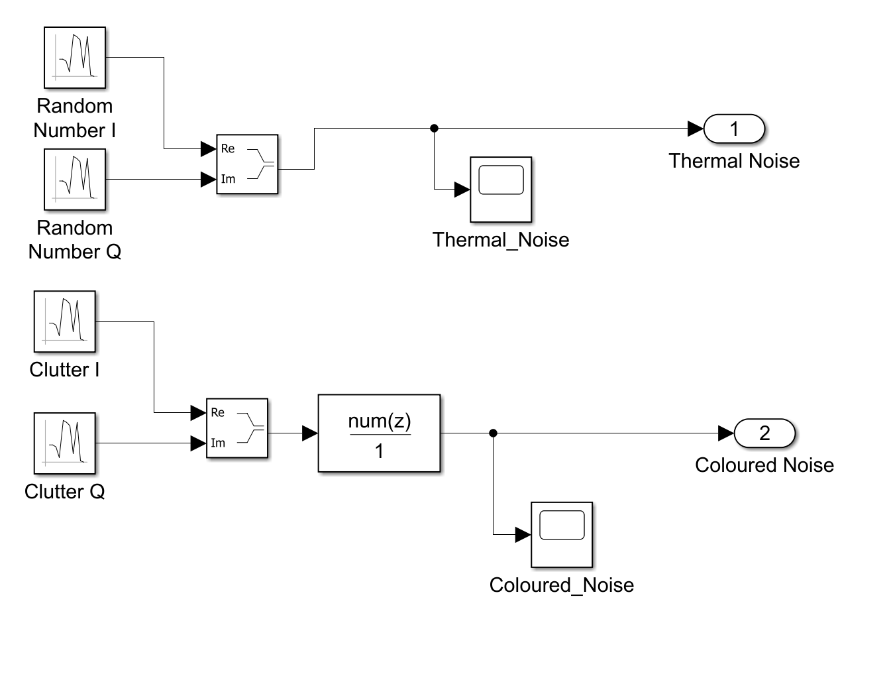
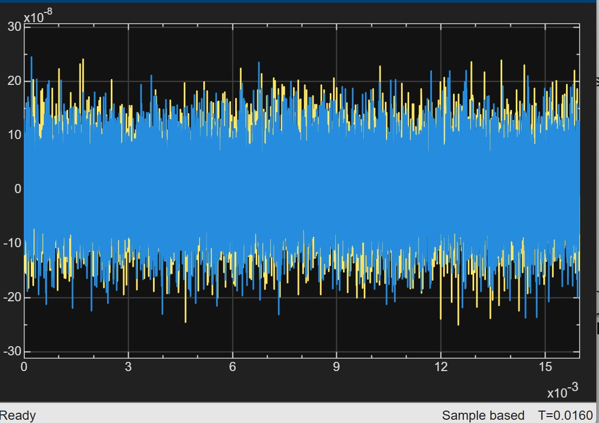
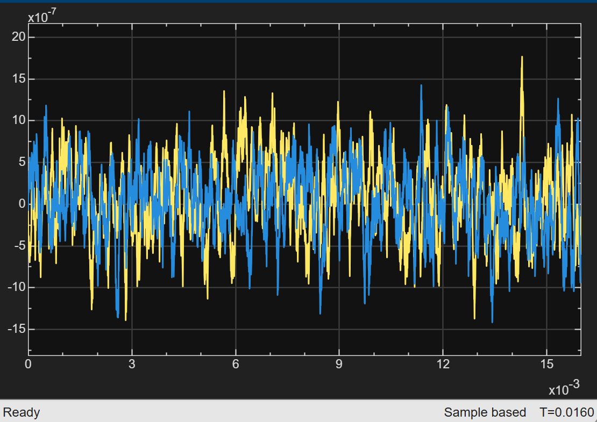

# 03 · Noise

> Adds the two things the receiver must separate the target from: receiver thermal noise and correlated clutter.

**Output:** complex noise samples, summed with the echo in [04 Signal](../04-signal/README.md)



---

## Thermal noise

Noise power comes from a receiver link budget rather than an arbitrary variance:

$$ P_n = k_B\,T_0\,B\,F, \qquad \sigma^2_{I} = \sigma^2_{Q} = \frac{P_n}{2} $$

```matlab
k_B = 1.38e-23;             % Boltzmann constant (J/K)
T0  = 290;                  % standard temperature (K)
B   = 1 / Ts;               % receiver bandwidth (1 MHz)
NF_dB = 3;  F = 10^(NF_dB/10);
Pn  = k_B * T0 * B * F;     % ≈ 8.0e-15 W (−111 dBm)
noise_variance_IQ = Pn / 2; % per I/Q channel
```

The power is split equally between I and Q so that the complex noise has total power $P_n$.

The thermal branch is two Gaussian Random Number blocks, `Random Number I` (variance `noise_variance_IQ`, seed `current_seed`) and `Random Number Q` (seed `current_seed + 1`), both with sample time `Ts`, combined by a Real-Imag to Complex block.

**Resulting SNR.** Per sample, $P_r/P_n$ for the three reference targets (mean RCS 1 m², before fading, with $P_n \approx 8.0\times10^{-15}$ W):

| Target | $R$ | $P_r$ | Per-sample SNR | After matched filter (Hamming, +18.6 dB) |
|---|---|---|---|---|
| 1 | 20 km | 1.79 × 10⁻¹² W | 224 = **23.5 dB** | ≈ 42.1 dB |
| 2 | 40 km | 1.12 × 10⁻¹³ W | 14.0 = **11.5 dB** | ≈ 30.1 dB |
| 3 | 70 km | 1.19 × 10⁻¹⁴ W | 1.5 = **1.7 dB** | ≈ 20.4 dB |

The matched-filter gain is explained in [04 Signal](../04-signal/README.md). These are nominal figures for a slow target; the Swerling fluctuation ([02 Echo](../02-echo/README.md)) moves the actual value of each target up or down from run to run.

---

## Coloured clutter

Clutter (e.g. rain) is correlated from sample to sample, unlike thermal noise. It is modelled by passing white Gaussian noise through an FIR shaping filter.

In the model, `Clutter I` (seed `current_seed + 2`) and `Clutter Q` (seed `current_seed + 3`), Gaussian Random Number blocks with sample time `Ts`, feed a Real-Imag to Complex block, then a Discrete FIR Filter, then the `Coloured Noise` outport. The thermal branch is the same without the filter.

> **Simulated separately, not in the signal path.** The clutter block was built and simulated on its own. At the top level only `Noise` output 1 (`Thermal Noise`) is wired to the `Signal` subsystem (input 3); `Noise` output 2 (`Coloured Noise`) is deliberately left unconnected, so `Signal` input 4 is open. The end-to-end results (range–Doppler maps, CFAR tests) therefore use thermal noise only. Connecting output 2 to input 4 would add the clutter.

The Discrete Filter numerator is

```matlab
num = ones(1, 100) / 10;    % 100-tap moving average, scaled by 1/10
```

Because every tap is $1/10$, each output sample is a scaled sum of the last 100 inputs, so neighbouring samples share most of their inputs and are strongly correlated.

| Property | Value |
|---|---|
| Power gain | $\sum h^2 = 100 \times (1/10)^2 = 1$, so the clutter keeps the power of its source; the $1/10$ scaling is what preserves it (a $1/100$ average would shrink it 100×) |
| Autocorrelation | triangular, $r[m] = \sigma^2 (1 - \lvert m \rvert / 100)$, so samples stay correlated for 100 samples (100 µs, the pulse width) |
| Spectrum | $\lvert H(f)\rvert^2 = \dfrac{\sin^2(100\pi f T_s)}{100\,\sin^2(\pi f T_s)}$, a low-pass shape peaking at DC (gain 100, +20 dB) |
| First null | $1/(100\,T_s)$ = 10 kHz |
| −3 dB point | about 4.4 kHz |

So the clutter power sits mostly below about 10 kHz, around zero Doppler, which is where real ground and rain clutter lies. White thermal noise is flat across the whole 1 MHz band.

**Clutter power.** The `Clutter I` and `Clutter Q` Random Number blocks use a variance of `noise_variance_IQ * 50`, which is 50× the thermal variance per channel. Since the filter's power gain is 1, the coloured clutter has the same power:

| Quantity | Value |
|---|---|
| Variance per channel | $50 \times 4.0\times10^{-15} = 2.0\times10^{-13}$ (rms $\approx 4.5\times10^{-7}$) |
| Total complex clutter power | $4.0\times10^{-13}$ W ($50\,P_n$) |
| Clutter-to-noise ratio | 50, i.e. **17 dB** above thermal |
| Signal-to-clutter, per sample | target 1: $P_r / P_c \approx 1.8\times10^{-12} / 4.0\times10^{-13} \approx 4.5$, i.e. **6.5 dB**; target 2: **−5.5 dB**; target 3: **−15.2 dB** (if connected, the clutter would be stronger than both distant targets per sample) |

The rms agrees with the `Coloured Noise` scope, whose waveform swings a few $10^{-7}$ either side of zero, against $\sigma \approx 6\times10^{-8}$ for the thermal noise.

**Why it matters.** Correlated clutter raises the local average that CA-CFAR uses, so it can lift the threshold above the target and mask it. That observation motivated adding the MTI canceller ([04 Signal](../04-signal/README.md)).

---

## Verification


*Thermal noise: white, zero-mean, variance `noise_variance_IQ` per channel.*


*Coloured clutter: visibly smoother (correlated) than the thermal noise.*

---

[← 02 Echo](../02-echo/README.md) · [Index](../../README.md) · [04 Signal →](../04-signal/README.md)
