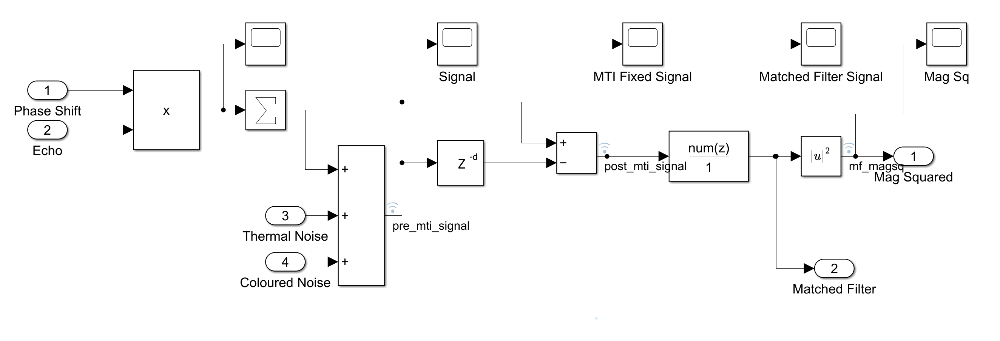
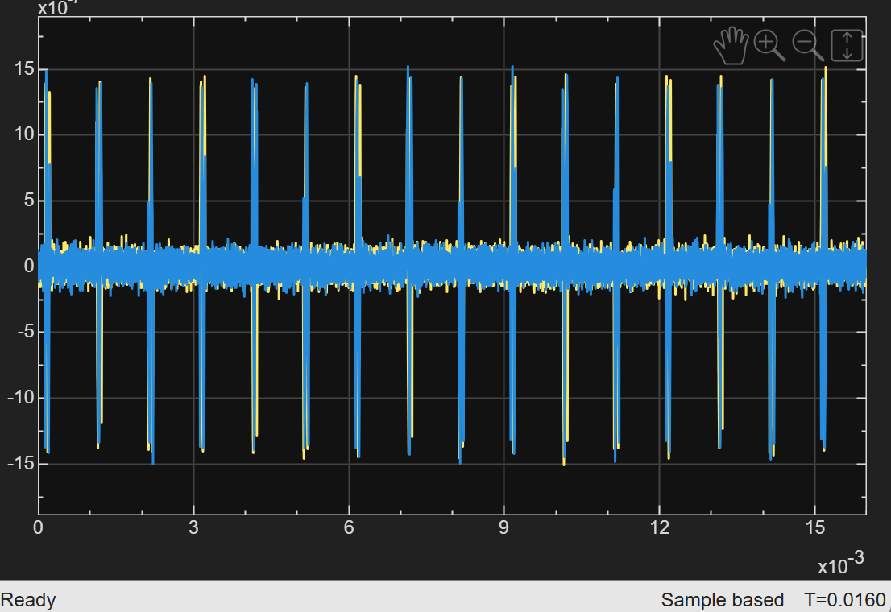
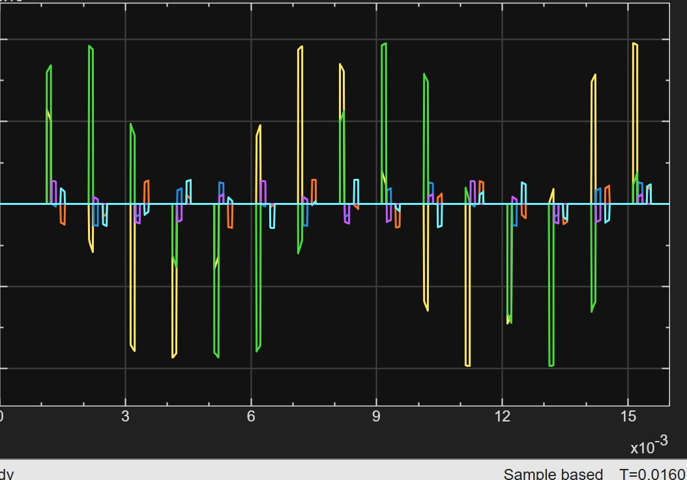
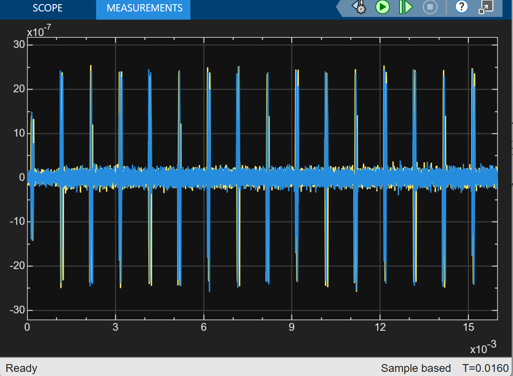
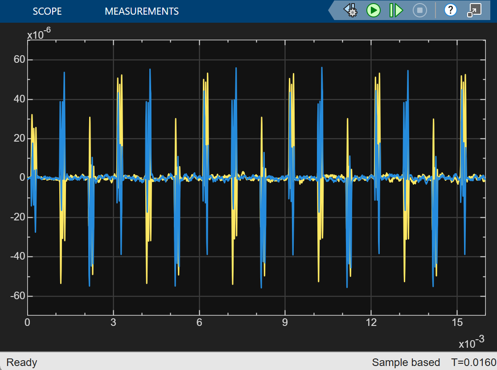
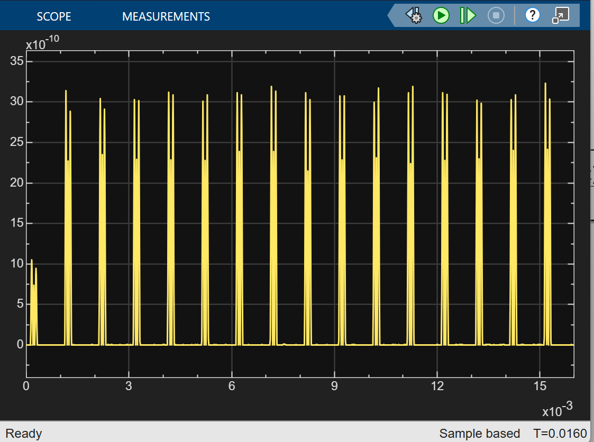
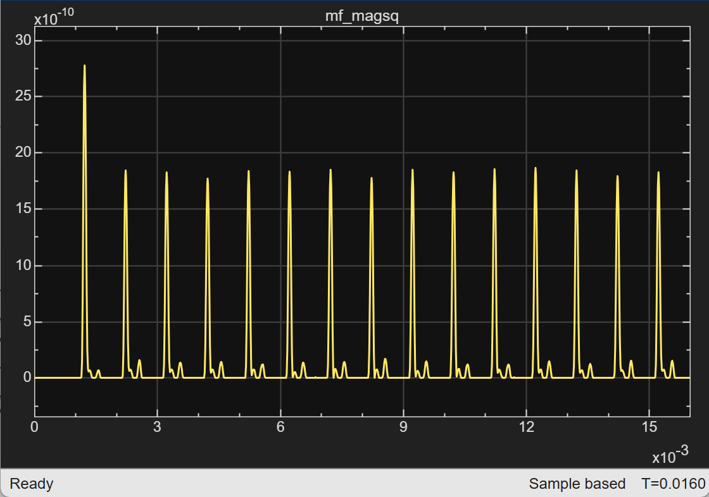

# 04 · Signal

> Builds the received signal and runs the core receive chain: MTI clutter cancellation, matched filtering and square-law detection.

**Inputs:** Phase Shift, Echo, Thermal Noise, Coloured Noise
**Outputs:** `Mag Squared` → [05 CFAR](../05-cfar/README.md); `Matched Filter` → [08 Velocity](../08-velocity/README.md) and [09 Range-Doppler](../09-range-doppler/README.md)



Three signals are tagged for logging: `pre_mti_signal` (the composite sum), `post_mti_signal` (MTI output) and `mf_magsq` (the output of the $|u|^2$ block, i.e. matched-filter **power**, which is also the `Mag Squared` port).

```
Echo (N ch) × Phase Shift (N ch) ─► Σ (sum of elements) ─┐
Thermal noise ───────────────────────────────────────────┼─(+)─► x[n] ─► MTI ─► Matched filter ─► |·|² ─► Mag Squared
Coloured noise (input left open, see 03) ────────────────┘                            └──────────────────► Matched Filter
```

The Echo and Phase Shift subsystems each deliver one channel per target. The Product block multiplies them channel by channel, and a Sum of Elements block (Σ) adds the channels into the single stream that a real receiver would see. Everything after that point is single-channel and does not know how many targets there are.

> **Input 4 is left open.** The coloured-noise (clutter) block was simulated on its own and is deliberately not connected to this subsystem at the top level (see [03 Noise](../03-noise/README.md)), so the sum is the target echoes plus thermal noise only.

---

## 4a · Composite signal

$$ x[n] = \sum_{k=1}^{N} a_k\,s[n - d_k]\,e^{j2\pi f_{d,k} nT_s} + c[n] + w[n] $$

Each target's echo $a_k s[n - d_k]$ (amplitude $a_k$, delay $d_k$) with its own Doppler phasor $f_{d,k}$, summed over the $N$ targets, plus clutter $c[n]$ and thermal noise $w[n]$. Everything downstream exists to separate the first term from the other two.


*Composite signal from the earlier single-target model (one echo train plus noise).*


*Doppler-shifted echoes of the three targets (I and Q of each, six traces) after the Product block, before the Σ sum and before noise is added. The echoes start one PRI late because of the Echo chain latency ([02 Echo](../02-echo/README.md)), and each has a different amplitude because of the range and the Swerling draw.*

---

## 4b · MTI canceller (2-pulse)

$$ y[n] = x[n] - x[n - N_{PRI}], \qquad H(z) = 1 - z^{-N_{PRI}} $$

Built from a delay of `MTI_delay = N_PRI = 1000` samples and a subtraction. Anything identical from one pulse to the next (stationary clutter) cancels; a moving target's phase has changed, so it survives.

**Frequency response.** $|H| = 2\,|\sin(\pi f_d\,\text{PRI})|$. It is zero whenever $f_d\,\text{PRI}$ is an integer, i.e. at the **blind speeds**

$$ v_{blind} = k\,\frac{\lambda}{2\,\text{PRI}} = k \times 15 \text{ m/s} $$

At 200 m/s, $f_d\,\text{PRI} = 13.33$, so the fractional part 0.33 gives $|H| = 1.73$ (+4.8 dB). A target at 30, 60 or 150 m/s would be cancelled along with the clutter.

For the three reference targets the MTI power gain $|H|^2 = 4\sin^2(\pi f_d\,\text{PRI})$ is:

| Target | $v$ | $f_d\,\text{PRI}$ | $\lvert H\rvert^2$ |
|---|---|---|---|
| 1 | 2 m/s | 0.133 turn | 0.66 (−1.8 dB) |
| 2 | 3 m/s | 0.200 turn | 1.38 (+1.4 dB) |
| 3 | 4 m/s | 0.267 turn | 2.21 (+3.4 dB) |

All three are far from a blind speed, but they are not treated equally: the slowest target is attenuated and the fastest is boosted by 5.2 dB relative to it.

**Startup transient.** The first echo arrives in the second PRI ([02 Echo](../02-echo/README.md)), when the delayed copy is the empty first PRI, so that echo passes through uncancelled. From then on each echo is subtracted from the previous PRI's echo. In the `mf_magsq` plot below the first peak is about 1.5 times (1.9 dB) the later ones, which matches the −1.8 dB gain of target 1 (the strongest target) in steady state.


*MTI output from the earlier single-target model.*

---

## 4c · Matched filter

$$ y[n] = \sum_{k=0}^{N_{\tau_p}-1} h[k]\,x[n-k], \qquad h[k] = w[k]\; s^*[N_{\tau_p}-1-k] = w[k] $$

The transmit pulse is a rectangle, so the flipped, conjugated pulse is all ones and a plain matched filter would be a 100-tap moving sum (`ones(1, N_tau_p)`). The model weights it with a Hamming window instead:

```matlab
range_window = hamming(N_tau_p)';   % 1x100, 0.08 at the ends, 1.0 in the middle
```

The Discrete Filter numerator is `range_window`, so the filter is the pulse shape times a taper: slightly mismatched on purpose.

| Property | Rectangular (`ones`) | Hamming (`range_window`) |
|---|---|---|
| Sum of taps | 100 | 53.5 |
| Peak power for a slow target | 1 | 0.287 (−5.4 dB) |
| Noise power gain, $\sum h^2 / N$ | 1 | 0.393 (−4.0 dB) |
| SNR gain, $(\sum h)^2 / \sum h^2$ | 20.0 dB | 18.6 dB |
| Loss at 200 m/s, relative to 5 m/s | −12.4 dB | −9.2 dB |

**Output shape.** The output is the running sum of the taps as the echo slides under the filter, so it is still 2 × 100 − 1 = 199 samples wide, but its edges are rounded and low (the ends of the window weigh little) instead of the straight ramps of a triangle. The taps are symmetric, so the peak still lands `matched_filter_delay = N_tau_p − 1 = 99` samples after the echo starts, i.e. at sample 133 + 99 = **232** for target 1, and the delay budget in [07 Range](../07-range/README.md) is unchanged. For the three reference targets the peaks sit at samples 232, 366 and 566, which are rows 233, 367 and 567 of the 1-based range–Doppler map.

**Processing gain.** Coherent summation gives $(\sum h)^2/\sum h^2 = 18.6$ dB of SNR gain, 1.4 dB less than the 20 dB of the unweighted filter, so the per-sample 23.5 dB becomes about 42.1 dB for a slow target.

**Doppler sensitivity.** The filter assumes constant phase across the pulse. At 200 m/s the phase turns 1.33 times within the pulse, the sum partly cancels and the response splits into lobes. The taper weights the middle of the pulse, where less phase has accumulated, so the Hamming filter loses less than the rectangular one (−9.2 dB against −12.4 dB at 200 m/s). This is quantified in the [velocity sweep](../../analysis/README.md).

**Range weighting history.** Hamming weighting was introduced to lower the sidelobes of the 2D range–Doppler map, and at one point it broke the 1D CFAR guard sizing and range extraction. That debugging is written up in [07 Range](../07-range/README.md). The model currently uses the Hamming filter. A separate unweighted branch for the 1D path is a possible future change.


*Matched-filter output from the earlier single-target model.*

---

## 4d · Square-law detector

$$ u[n] = |y[n]|^2 = y_I^2[n] + y_Q^2[n] $$

Converts the complex filter output to real power. CA-CFAR's threshold multiplier assumes exactly this statistic (exponentially distributed noise power).


*Magnitude squared from the earlier single-target model.*


*`mf_magsq` for the three reference targets over one CPI. Target 1 dominates, at about 1.8 × 10⁻⁹ after the first PRI. The first peak is larger (2.8 × 10⁻⁹) because the MTI has nothing to cancel it against yet. The other two targets show up as the much smaller peaks that follow each large one, at offsets that should be 134 and 334 samples (0.13 and 0.33 ms). Nominally they carry 12 dB and 22 dB less power than target 1, before the MTI gain of each target and each target's own Swerling draw.*

---

[← 03 Noise](../03-noise/README.md) · [Index](../../README.md) · [05 CFAR →](../05-cfar/README.md)
