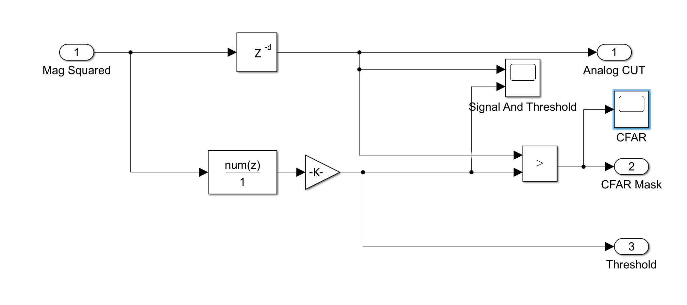
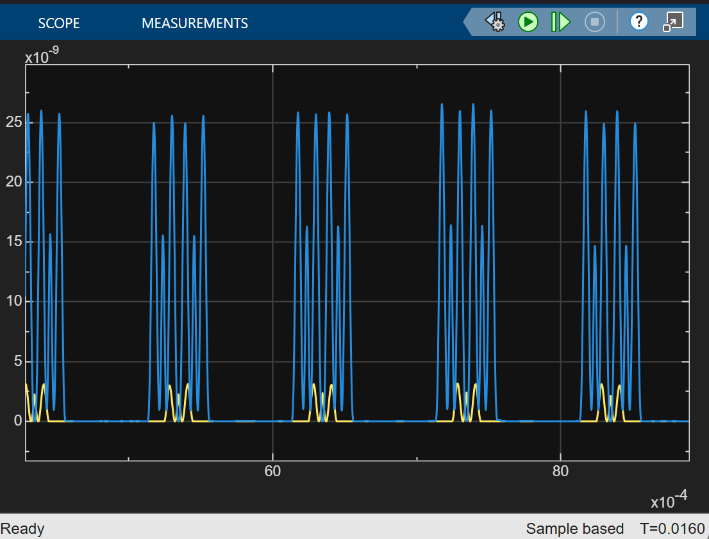
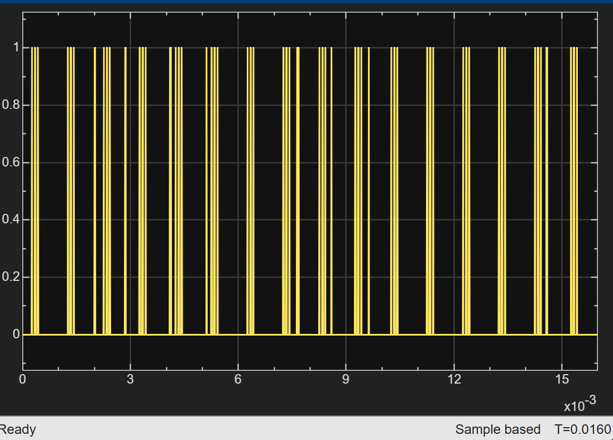

# 05 · CFAR (1D cell-averaging)

> Sets an adaptive detection threshold from the local noise level, so the false-alarm rate stays fixed whatever the background.

**Input:** `Mag Squared` from [04 Signal](../04-signal/README.md)
**Output:** binary CFAR mask → [06 Detection](../06-detection/README.md)



---

## How it works

For each cell under test (CUT):

1. Average the power in the **training cells** on either side.
2. Skip the **guard cells** next to the CUT, so the target's own energy does not inflate the noise estimate.
3. Scale that average by $\alpha$ and compare.

$$ T[n] = \alpha \cdot \frac{1}{N_{train}} \sum_{k\,\in\,\text{training}} u[n-k], \qquad \text{detect if } u[n] > T[n] $$

$$ \alpha = N_{train}\left(P_{fa}^{-1/N_{train}} - 1\right) $$

This $\alpha$ is exact for square-law detected Gaussian noise (exponential power), which is why CFAR sits after the $|\cdot|^2$ block.

---

## Implementation

The averaging is an FIR filter, which keeps it HDL-portable:

```matlab
Pfa     = 1e-6;
N_train = 32;     % 16 leading + 16 lagging
N_guard = 200;    % 100 per side

alpha       = N_train * (Pfa^(-1/N_train) - 1);
cfar_window = [ones(1, N_train/2), zeros(1, N_guard + 1), ones(1, N_train/2)] / N_train;
cfar_delay  = (N_train/2) + (N_guard/2);
```

| Parameter | Value | Reason |
|---|---|---|
| $P_{fa}$ | 10⁻⁶ | one false alarm per million cells |
| $N_{train}$ | 32 | enough averaging for a stable noise estimate |
| $N_{guard}$ | 200 | covers the 199-sample matched-filter triangle |
| $\alpha$ | 17.3 (12.4 dB) | from the formula above |
| `cfar_delay` | 116 samples | aligns the CUT with its threshold |

**Guard sizing matters.** If the guard band is narrower than the triangle, training cells sit on the target's slopes, the noise estimate rises near the peak, and the peak can fail its own test while the slopes pass.

---

## Verification


*Square-law signal and adaptive threshold: the threshold follows the noise floor and the target crosses it.*


*CFAR mask: high over the part of the triangle that exceeds the threshold. In this capture it appears as several short bursts per pulse rather than one solid block.*

---

## Known limitations

- **Masking:** a second target inside the training window raises the threshold and can hide a weaker one.
- **Clutter edges:** a sharp step in clutter power inflates the estimate on one side and causes false alarms on the other.
- **Pfa not yet validated empirically.** Planned: noise-only Monte Carlo to check the measured false-alarm rate against 10⁻⁶. (An OS-CFAR comparison has been done for the 2D path, see [09 Range-Doppler](../09-range-doppler/README.md#os-cfar-order-statistic) and the [analysis](../../analysis/README.md#c-ca-cfar-versus-os-cfar-multi-target-tests).)

---

[← 04 Signal](../04-signal/README.md) · [Index](../../README.md) · [06 Detection →](../06-detection/README.md)
