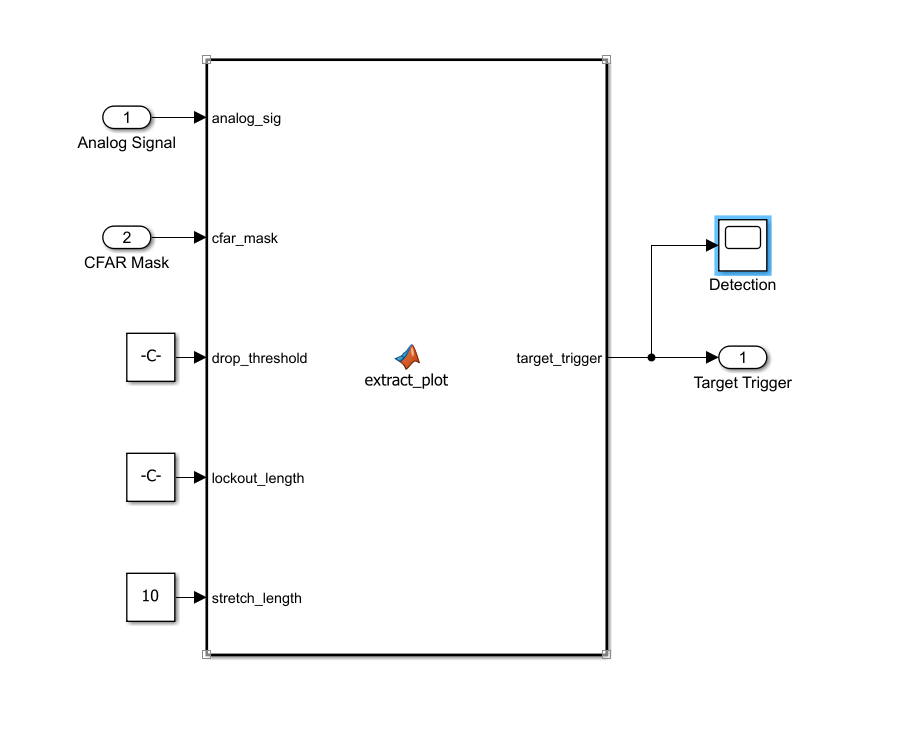
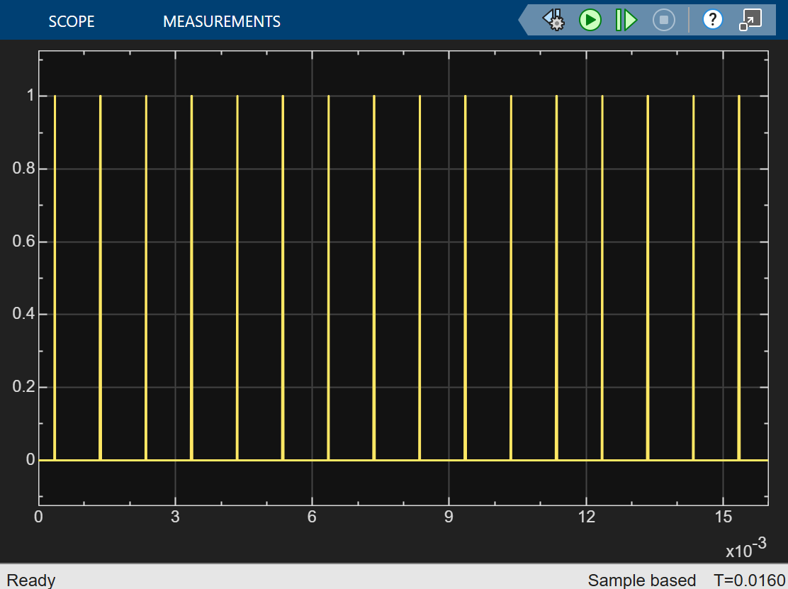

# 06 · Detection

> Turns the CFAR mask, which is high for many consecutive samples, into exactly one trigger per target return.

**Inputs:** `Mag Squared` signal, CFAR mask
**Output:** single trigger pulse → [07 Range](../07-range/README.md), [08 Velocity](../08-velocity/README.md)



---

## Why it is needed

The matched-filter triangle is wide, so the CFAR mask stays high for many samples. Triggering on the mask directly would report one target many times. This block waits until the signal has **passed its peak**, fires once, then ignores the rest of that return.

---

## Implementation

```matlab
function target_trigger = extract_plot(analog_sig, cfar_mask, drop_threshold, lockout_length, stretch_length)
    persistent drop_counter lockout_timer last_sig display_timer;
    if isempty(drop_counter)
        drop_counter = 0; lockout_timer = 0; last_sig = 0; display_timer = 0;
    end

    target_trigger = 0;

    % 1. Stretch the trigger so it is visible on a scope
    if display_timer > 0
        target_trigger = 1;
        display_timer = display_timer - 1;
    end

    % 2. Count down the lockout
    if lockout_timer > 0
        lockout_timer = lockout_timer - 1;
    end

    % 3. Peak logic: fire after drop_threshold consecutive falling samples
    if cfar_mask == 1 && lockout_timer == 0
        if analog_sig < last_sig
            drop_counter = drop_counter + 1;
        else
            drop_counter = 0;
        end
        if drop_counter == drop_threshold
            target_trigger = 1;
            display_timer  = stretch_length;
            lockout_timer  = lockout_length;
            drop_counter   = 0;
        end
    else
        drop_counter = 0;
    end

    last_sig = analog_sig;
end
```

| Parameter | Value | Role |
|---|---|---|
| `drop_threshold` | 8 samples | consecutive falls needed to confirm the peak has passed (rejects noise wiggles) |
| `lockout_length` | 1.5 × `N_tau_p` = 150 samples | samples ignored after a trigger |
| `stretch_length` | 10 samples | trigger display width (Constant block wired to the function) |

**Latency.** The trigger fires `drop_threshold = 8` samples after the true peak. This is included in the range compensation (`drop_threshold_delay = 8`).

---

## Verification


*One trigger per pulse, fired just after the matched-filter peak.*

---

[← 05 CFAR](../05-cfar/README.md) · [Index](../../README.md) · [07 Range →](../07-range/README.md)
