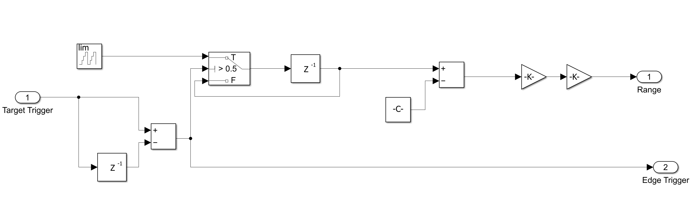

# 07 · Range

> Converts the sample index of the detection trigger into a distance, after removing the latency added by the processing chain.

**Input:** trigger from [06 Detection](../06-detection/README.md)
**Output:** target range (m)



---

## Theory

Each sample is 1 µs of round-trip time, and the wave travels out and back:

$$ \Delta R = \frac{c\,T_s}{2} = 150 \text{ m per sample} $$

The trigger does not fire at the echo's arrival. Every stage adds delay, so the index must be corrected before converting:

$$ R = \left(n_{trigger} - n_{pipeline}\right)\cdot\frac{c\,T_s}{2} $$

---

## Pipeline delay budget

| Stage | Delay | Why |
|---|---|---|
| Matched filter | 99 samples | full overlap at $N_{\tau_p} - 1$ |
| CFAR alignment | 116 samples | $N_{train}/2 + N_{guard}/2$ |
| Detection | 8 samples | fires after 8 falling samples |
| **Total** `hardware_delay_samples` | **223 samples** | |

```matlab
range_per_sample       = (c * Ts) / 2;   % 150 m
hardware_delay_samples = matched_filter_delay + cfar_delay + drop_threshold_delay;   % 223
```

**Echo chain latency.** The Echo's FFT/IFFT chain ([02 Echo](../02-echo/README.md)) delays every return by exactly one PRI (`echo_chain_delay = N_PRI = 1000` samples). The counter in this block wraps every PRI, so a delay of exactly one PRI drops out and 223 is still the right figure. `init.m` also defines `hardware_delay_total = 223 + 1000 = 1223` for an index that never resets.

**Several targets.** This block was built for a single return. It captures the counter once per trigger and holds it until the next trigger, so with several targets its output is the range of the most recent trigger, not a list of all of them. The range of every target comes from the 2D chain in [09 Range-Doppler](../09-range-doppler/README.md).

---

## How the block diagram works

The diagram does two jobs: it captures the sample index at which the trigger fires, then converts that index to a distance. It reads in three parts.

**1. Edge detector (bottom left).** `Target Trigger` goes into a sum block twice: directly, and through a one-sample delay (`z⁻¹`) on the minus input. The output is `trigger[n] − trigger[n−1]`, which is +1 only on the first sample of a trigger, 0 while it stays high, and −1 when it falls. This is needed because [06 Detection](../06-detection/README.md) stretches each trigger to about 11 samples so it shows on a scope, and the range logic wants one instant, not a pulse. The same edge signal leaves as output 2, `Edge Trigger`, which [08 Velocity](../08-velocity/README.md) uses to know when to sample.

**2. Sample and hold (top middle).** The block marked `lim` is a limited counter that counts samples and wraps every PRI, so its value is the position inside the current PRI (fast time). A Switch with the test `> 0.5` is controlled by the edge:
- When the edge is 1, the switch passes the live counter value (the `T` input).
- Otherwise it passes its own previous output back round through a `z⁻¹` (the `F` input).

So the loop acts as a register: it grabs the counter at the instant of each trigger and keeps that value until the next trigger. Because the counter wraps every PRI, the stored index never grows with pulse number, and the displayed range stays steady between triggers.

**3. Convert to range (top right).** The held index goes into a sum block, which subtracts the Constant (`-C-`), the 223-sample pipeline delay from the budget above. Two gains then follow. One is `range_per_sample` = 150 m. The other is not visible in the screenshot, but the display reads 19.95, so it is presumably a 1/1000 scaling to km. This is the formula $R = (n_{trigger} - n_{pipeline}) \cdot cT_s/2$ from the Theory section.

**Worked example.** The echo starts at sample 133, the matched-filter peak is at 232, the CFAR alignment adds 116 and detection adds 8, so the trigger fires at sample 232 + 116 + 8 = 356 of the PRI. The register holds 356. Subtracting 223 leaves 133 samples, and 133 × 150 m = 19,950 m = **19.95 km**.

The screenshot shows no block parameters, so the counter's wrap value, the Constant and the gain values are taken from the delay budget and the displayed result, not read from the dialogs.

---

## Result

| | Value |
|---|---|
| True range | 20.00 km |
| Expected (quantised to 150 m bins) | 133 × 150 m = 19.95 km |
| **Measured** | **19.95 km** |

The 50 m difference from 20 km is range quantisation: 20 km is 133.3 samples, and the model can only report whole samples. (This is the single-target measurement. With the three-target scenario the 2D chain reports 19.95, 40.05 and 70.05 km for targets at 20, 40 and 70 km, see [09 Range-Doppler](../09-range-doppler/README.md).)

---

## How this number was actually found

The 19.95 km result above looks like it fell straight out of the formula. It didn't — the debugging is worth recording because it explains a real bug, not just a rounding note.

**Three different "delay" numbers appeared at different points:**

| Value | Where it came from |
|---|---|
| 100 samples | An early, since-corrected comment in `init.m` for `N_delay`, left over from an earlier `R` value |
| 133 samples | The correct value for `R = 20 km`, from `N_delay = round((2R/c)/Ts)` |
| 170 samples | The *measured* peak in the matched-filter output at the time — neither of the above |

The 170 didn't match either theoretical number, which was the actual clue. It turned out the matched filter's coefficients had been changed from a rectangular window (`ones(1, N_tau_p)`) to a Hamming-weighted window (`range_window`), to reduce sidelobes in the 2D range-Doppler map. That change:

- widened and reshaped the matched-filter response (expected, and fine for the 2D path), and
- **shifted and mismatched the 1D range/velocity path**, which had been tuned (CFAR guard cells, `matched_filter_delay`) around the sharp rectangular triangle.

Reverting the matched filter to `ones(1, N_tau_p)` for the 1D path restored range to 19.95 km and velocity to the expected aliased value. The lesson kept in the design: **the matched filter used for range/CFAR and the one used for the 2D Doppler map have different, competing requirements (sharp peak vs. low sidelobes), and sharing one filter between both paths silently breaks one of them.** A cleaner fix — a separate Hamming-weighted branch feeding only the 2D map — is listed under future work.

**Update.** The matched filter in the current model is the Hamming-weighted `range_window` again (see [04 Signal](../04-signal/README.md)). The delay budget above still holds, because the taps are symmetric and the peak stays at `N_tau_p − 1`.

---

## Range limits of this design

| Quantity | Formula | Value |
|---|---|---|
| Range bin | $cT_s/2$ | 150 m |
| Range resolution | $c\tau_p/2$ | **15 km** |
| Blind range | $c\tau_p/2$ | 15 km |
| Max unambiguous range | $c\cdot\text{PRI}/2$ | 150 km |

The 150 m bin is how finely one target's position is reported. The **15 km resolution** is how close two targets can be before their triangles merge into one. Pulse compression (an LFM chirp) is the standard way to decouple resolution from pulse energy, and is listed as future work.

---

[← 06 Detection](../06-detection/README.md) · [Index](../../README.md) · [08 Velocity →](../08-velocity/README.md)
