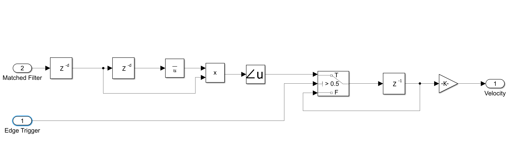
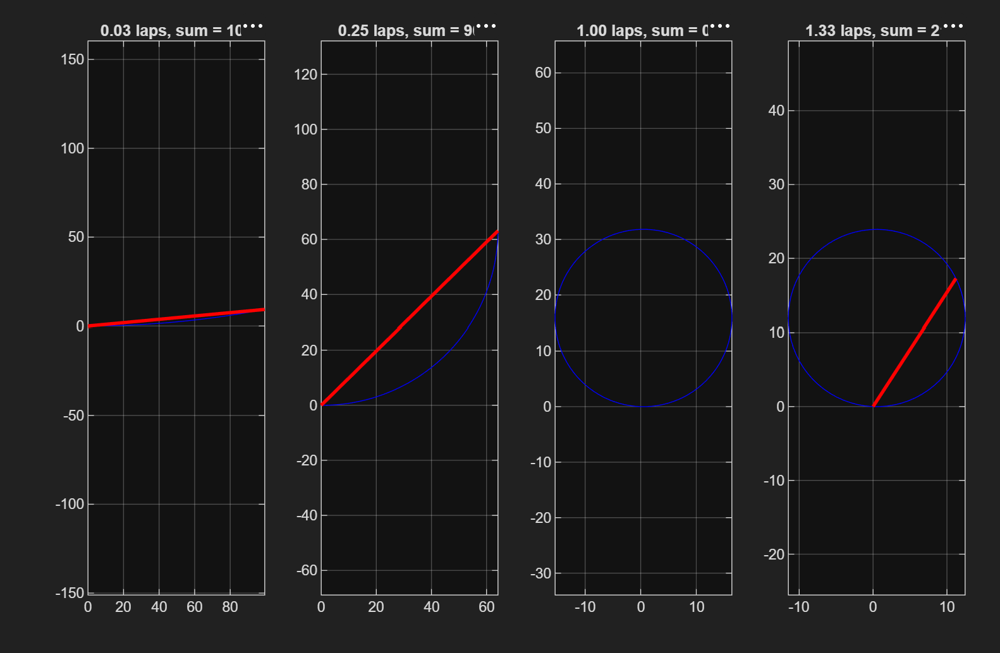
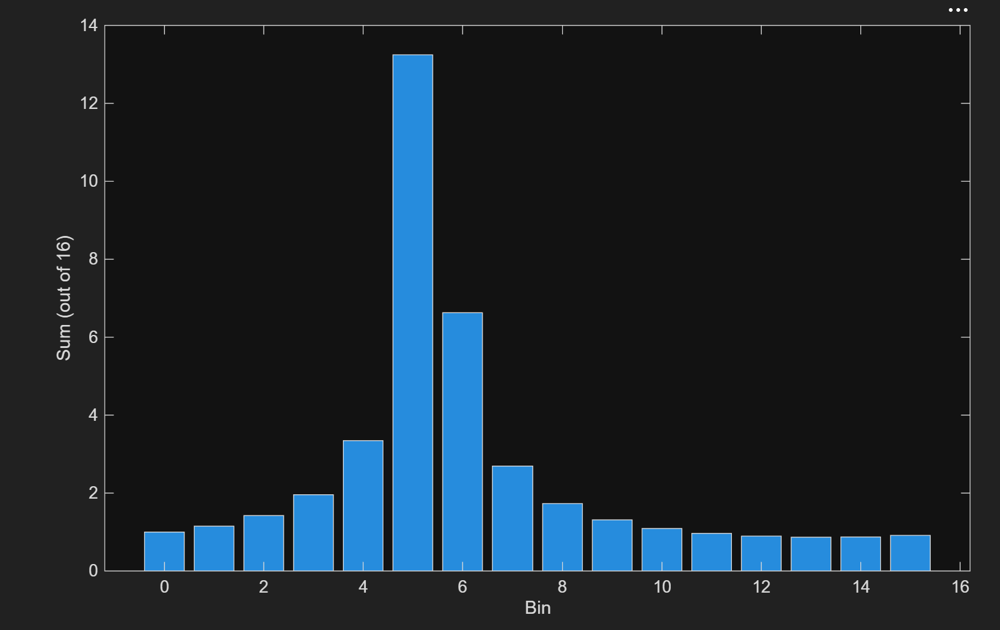

# 08 · Velocity (pulse-pair)

> Estimates radial velocity from the phase change of the target return between two consecutive pulses.

**Inputs:** matched-filter output, detection trigger
**Output:** target velocity (m/s)



---

## Theory

At the detected range bin, compare the sample from this pulse with the one from the previous pulse:

$$ \Delta\phi = \angle\left(x[n]\,x^*[n - N_{PRI}]\right) $$

The phase advances by $2\pi f_d\,\text{PRI}$ per pulse, so

$$ f_d = \frac{\Delta\phi}{2\pi\,\text{PRI}}, \qquad v = \frac{f_d\,\lambda}{2} $$

Multiplying by the conjugate cancels the unknown starting phase and keeps only the change between pulses.

---

## How the block diagram works

The diagram builds the product $x[n]\,x^*[n - N_{PRI}]$ from the matched-filter output, takes its angle, holds that value at each trigger and scales it to m/s. It reads left to right in three parts.

**1. Line up the samples (left, two `z⁻ᵈ` blocks and the conjugate).** The input is the complex `Matched Filter` signal, not the magnitude², because the phase is what carries the velocity.
- The first `z⁻ᵈ` delays it so that the sample being looked at is the matched-filter *peak* when the trigger arrives. The trigger fires after the peak (CFAR alignment plus detection latency, see [07 Range](../07-range/README.md)), so the signal has to be held back to meet it.
- The output of that delay is split. One copy goes straight to the multiplier. The other goes through the second `z⁻ᵈ`, which is one full PRI (`N_PRI` = 1000 samples), and then the conjugate block (the bar over `u`). That is the same range bin, one pulse earlier.

**2. Multiply and take the angle (middle).** The multiplier forms this pulse's sample times the conjugate of the previous pulse's sample. The result has the amplitude product and a phase equal to the pulse-to-pulse phase step. The `∠u` block returns that phase $\Delta\phi$ in $(-\pi, \pi]$, which is where the ±7.5 m/s limit comes from.

**3. Hold at the trigger and scale (right).** This is the same sample-and-hold as in [07 Range](../07-range/README.md). A Switch with the test `> 0.5` is controlled by `Edge Trigger`, the one-sample pulse from the Range block:
- On the edge, the switch passes the new angle (`T`).
- Otherwise it passes back its previous output through `z⁻¹` (`F`), so the last value is held.

The final gain `-K-` turns radians into m/s: $v = \Delta\phi \cdot \lambda / (4\pi\,\text{PRI}) \approx 2.39$ m/s per radian. At the aliased 0.33 turn, $\Delta\phi = 2\pi/3 = 2.09$ rad, which gives 5.0 m/s.

The screenshot shows no block parameters, so the two delay lengths and the gain are inferred from the theory above, not read from the dialogs. The first delay is presumably `cfar_delay + drop_threshold_delay` = 124 samples, since the trigger fires at sample 356 and the peak is at 232.

Two behaviours to expect:
- **First pulse:** there is no earlier pulse yet, so the delayed copy is zero and the first held value is 0 m/s. The reading is valid from the second trigger.
- **Small run-to-run differences** (5.031 and 5.047 m/s have both been seen): the estimate uses a single sample pair at the trigger, with no averaging, so noise on that pair shifts the phase slightly. This is the most likely cause, not confirmed.

---

## Unambiguous velocity

$\angle(\cdot)$ only returns values in $(-\pi, \pi]$. A phase step larger than half a turn looks like a smaller step backwards (the wagon-wheel effect):

$$ v_{max} = \frac{\lambda}{4\,\text{PRI}} = \frac{0.03}{4 \times 0.001} = 7.5 \text{ m/s} $$

```matlab
V_max = lambda/(4*Ts*N_PRI);   % Ts*N_PRI = PRI  →  7.5 m/s
```

Velocities repeat every $2v_{max} = 15$ m/s.

---

## Result: aliasing of the 200 m/s target

| Step | Value |
|---|---|
| True velocity | 200 m/s |
| Phase turns per pulse, $f_d\cdot\text{PRI}$ | 13.33 |
| Observable remainder | 0.33 turn |
| Expected reported velocity | 200 mod 15 = **5.0 m/s** |
| **Measured** | **5.031 m/s** |

The estimator is working correctly. It reports the aliased velocity because 200 m/s is far outside ±7.5 m/s. Recovering the true value needs a higher PRF (which shortens the unambiguous range) or several PRFs with velocity unfolding.

(This is the single-target measurement. The current reference scenario has three targets at 2, 3 and 4 m/s, all inside ±7.5 m/s, so nothing aliases. This pulse-pair block was built for one return and holds the value from the most recent trigger; the velocity of every target comes from the 2D chain in [09 Range-Doppler](../09-range-doppler/README.md), which reports 2.0, 3.0 and 4.0 m/s to within 0.05 m/s.)

---

## How this was actually understood

The 5.03 m/s reading looked wrong at first — the target was set to 200 m/s, and the natural assumption was that the model had a bug. Working out why it was *correct* took untangling two separate, easily-confused effects that both come from the same root cause (a fast target), just on two different timescales.

**The intuition, built up step by step:**

- A baseband sample is a complex number — an "arrow" with a length (amplitude) and direction (phase). A matched filter or FFT sums these arrows tip-to-tail; arrows pointing the same way add up, arrows spread around the circle cancel.

  
  *The same 100 unit arrows summed tip to tail (blue path), with the total turn across the pulse set to 0.03, 0.25, 1.00 and 1.33 laps. The red line is the sum: nearly the full 100 at 0.03 laps, and the path closes on itself at 1.00 lap so the sum is about zero.*

  ```matlab
  N = 100;                                  % samples in the pulse
  laps = [0.03 0.25 1.0 1.33];              % total turning across the pulse
  figure;
  for k = 1:4
      ang = 2*pi*laps(k)*(0:N-1)/N;         % arrow direction at each sample
      z = exp(1j*ang);                      % the arrows (length 1)
      path = [0 cumsum(z)];                 % walk tip to tail
      subplot(1,4,k);
      plot(real(path), imag(path), 'b'); hold on;
      plot([0 real(path(end))], [0 imag(path(end))], 'r', 'LineWidth', 2);
      axis equal; grid on;
      title(sprintf('%.2f laps, sum = %.0f', laps(k), abs(path(end))));
  end
  ```
- A moving target makes this arrow rotate at a constant rate from sample to sample, because its distance (and therefore the round-trip phase) keeps changing. That rotation rate is the Doppler frequency, $f_d = 2v/\lambda$ — derived from first principles in [01 Phase Shift](../01-phase-shift/README.md), not just asserted.
- This one rotation rate matters on **two different timescales**, and the two were initially conflated:
  - **Within one pulse** (100 samples, 100 µs): governs whether the *matched filter* still adds coherently — this is the mismatch-loss story in [04 Signal](../04-signal/README.md) and the [analysis](../../analysis/README.md) velocity sweep.
  - **Between pulses** (16 samples, 1 ms apart): governs what the *16-point Doppler FFT* can report — this page.
- The "wagon-wheel effect" was the picture that made the aliasing click: a camera taking snapshots of a spinning wheel can't distinguish a wheel that turned exactly one extra full rotation between frames from one that didn't turn at all. The radar's 16 pulses are 16 "photos" of the rotating arrow, taken once per PRI. If the arrow turns more than half a rotation between photos, the radar can't tell how many *extra* full turns happened — it only sees the leftover fraction.
- **Where 7.5 m/s comes from:** the largest unambiguous turn between snapshots is half a rotation. Setting $f_d \cdot \text{PRI} = 0.5$ and solving for $v$ gives $v_{max} = \lambda/(4\,\text{PRI}) = 7.5$ m/s — the same formula as above, but now understood as "half a turn per snapshot," not just a memorized equation.
- **Reconciling 200 m/s → 5 m/s:** at 200 m/s the arrow turns 13.33 times between pulses. The radar cannot see the 13 whole turns — only the leftover 0.33 turn, which is indistinguishable from a target genuinely rotating 0.33 turns per pulse, i.e. moving at $0.33 \times 15 = 5$ m/s. This was confirmed numerically (200 mod 15 = 5) and experimentally (running the sim at 5 m/s directly and comparing the range-Doppler map to the 200 m/s case — see [09 Range-Doppler](../09-range-doppler/README.md)).

  
  *A direct check of the 0.33-turn leftover: 16 arrows, one per pulse, each turned 5.333/16 of a turn from the last, through a 16-point FFT. The energy lands between bins 5 and 6 (13.3 in bin 5, 6.6 in bin 6, out of a maximum 16), which is where the range–Doppler map puts the target, in columns 6 and 7.*

  ```matlab
  k = 0:15;
  x = exp(1j*2*pi*(5.333/16)*k);            % 16 spinning arrows
  X = abs(fft(x));                          % size of each bin's sum
  bar(0:15, X); xlabel('Bin'); ylabel('Sum (out of 16)');
  ```

The two timescales were easy to mix up mid-debugging because both are driven by the same `fd`, and a fix that clarifies one (e.g. slowing the target to 5 m/s to get a clean range profile) can silently mask the other. Keeping the two effects in clearly separate sections here and in [04 Signal](../04-signal/README.md) was a deliberate response to that confusion.

---

[← 07 Range](../07-range/README.md) · [Index](../../README.md) · [09 Range-Doppler →](../09-range-doppler/README.md)
