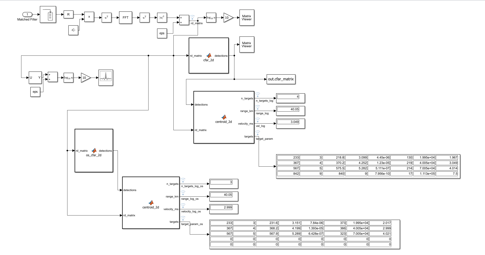
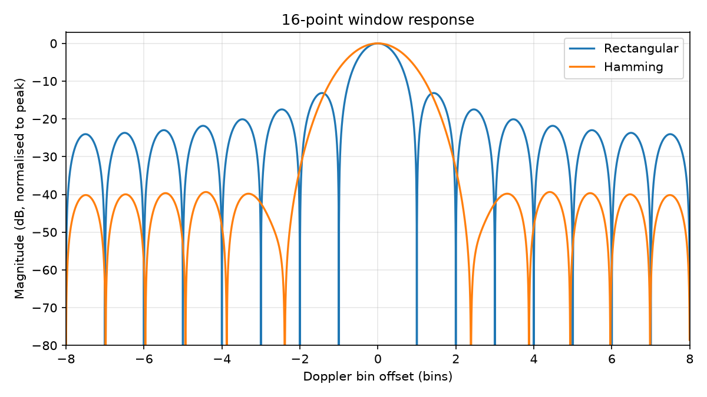
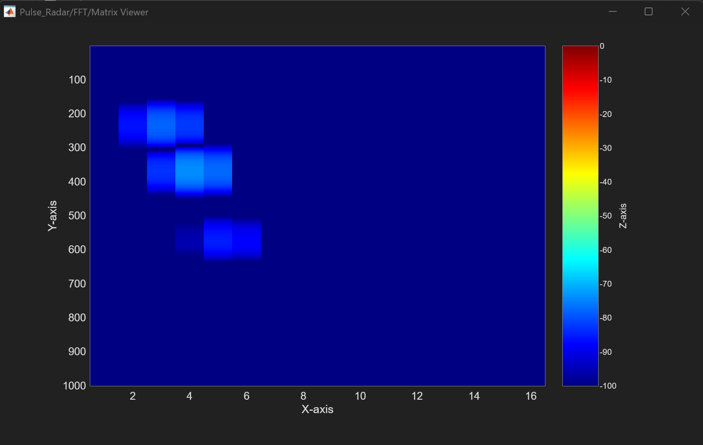
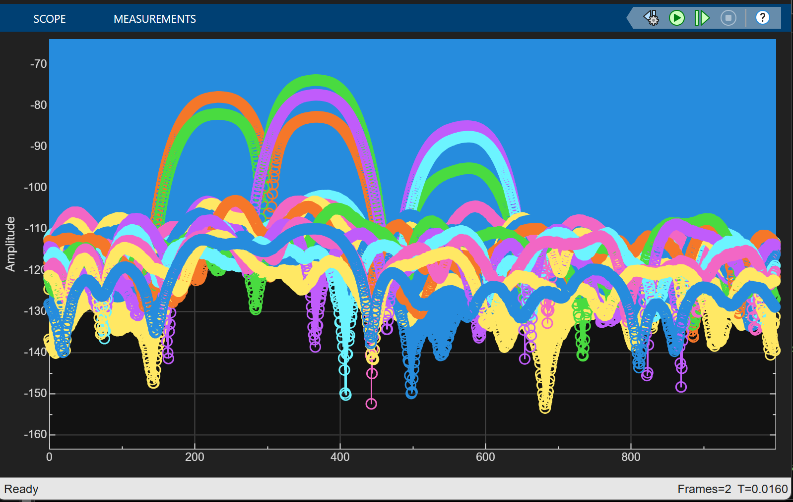
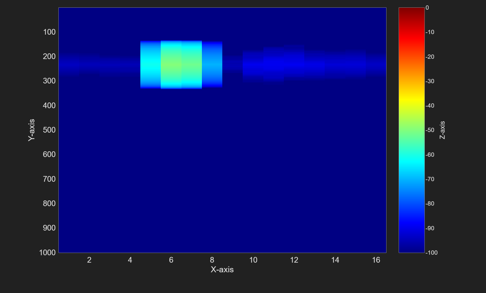
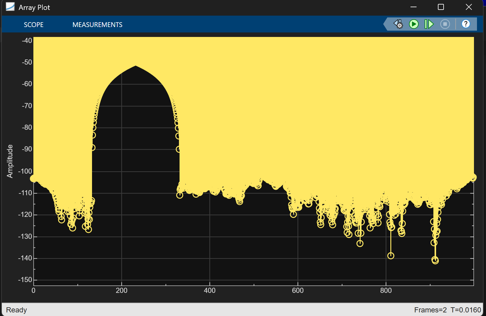
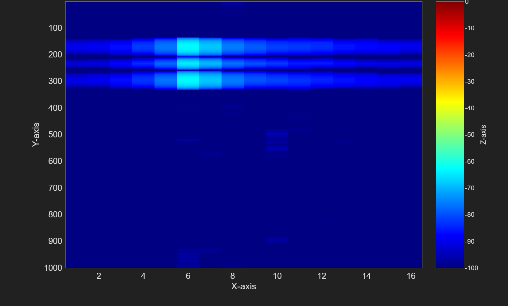
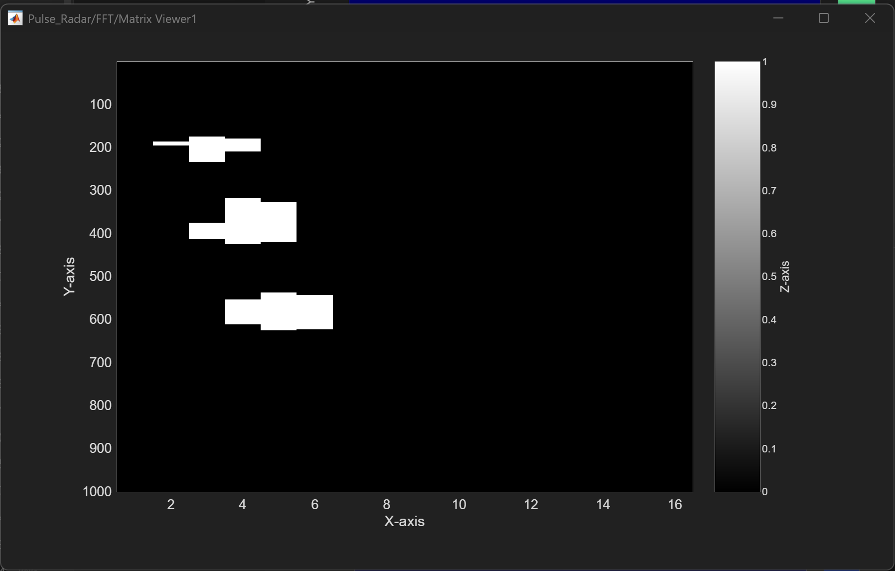
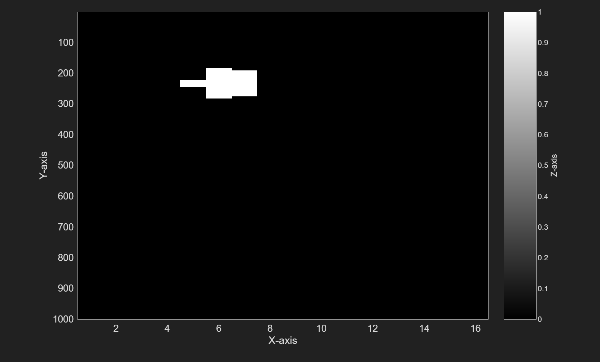

# 09 · Range-Doppler (CPI FFT, 2D CFAR, centroiding)

> Collects 16 pulses, runs an FFT across them at every range bin to build a range–Doppler map, detects targets on that map with 2D CFAR (a cell-averaging and an order-statistic version side by side), and groups each detection region into one report per target.

**Input:** `Matched Filter` output from [04 Signal](../04-signal/README.md)
**Outputs:** range–Doppler power map `rd_matrix` (Matrix Viewer), the CA-CFAR detection map `out.cfar_matrix`, and for each CFAR a target list (`target_param`, `target_param_os`) with headline `n_targets`, `range_km` and `velocity_ms` values



---

## Block by block

| # | Block | What it does | Size after |
|---|---|---|---|
| 1 | Buffer | collects one CPI: 16 pulses × 1000 samples | 16000 × 1 |
| 2 | Reshape `[N_PRI, N_cpi]` | folds into range (rows) × pulse (columns) | 1000 × 16 |
| 3 | × Constant `repmat(doppler_window', 1000, 1)` | Hamming taper across the 16 pulses, the same for every range row | 1000 × 16 |
| 4 | Transpose | puts pulses along columns for the FFT block | 16 × 1000 |
| 5 | FFT | 16-point FFT for every range bin | 16 × 1000 |
| 6 | Transpose | back to range × Doppler | 1000 × 16 |
| 7 | magnitude² `+ eps` | power plus a tiny offset so the dB blocks never see `log10(0)`; this signal is `rd_matrix` and is logged | 1000 × 16 |
| 8 | 10·log10 → Matrix Viewer | display only | |
| 9 | `cfar_2d` | cell-averaging 2D CFAR on linear power; shown on a second Matrix Viewer (gray) and logged as `out.cfar_matrix` | 1000 × 16 binary |
| 10 | `centroid_2d` | groups the `cfar_2d` detections into clusters; outputs `n_targets`, `range_km`, `velocity_ms`, `targets` | 8 × 8 table |
| 11 | `os_cfar_2d` | order-statistic 2D CFAR on the same `rd_matrix` | 1000 × 16 binary |
| 12 | second `centroid_2d` | the same function on the OS-CFAR detections | 8 × 8 table |
| 13 | `U → Y`, `+ eps`, 10·log10 → Array Plot | display only: dB range profile | |

The outputs of blocks 10 and 12 go to Display blocks and are logged as `n_targets_log`, `range_log`, `vel_log`, `target_param` (cell-averaging) and the same names ending `_os` (order-statistic), which the test scripts in [analysis](../../analysis/README.md) read.

**Rows are fast time (range)**: position within a PRI. **Columns are slow time (pulse number)** before the FFT, and **Doppler bins** after it.

---

## What the FFT measures

At one range bin, the 16 samples (one per pulse) are snapshots of a phasor that advances by $2\pi f_d\,\text{PRI}$ each pulse:

$$ x[k] = A\,e^{j2\pi (f_d\,\text{PRI})\,k}, \qquad k = 0,\dots,15 $$

The DFT tests 16 candidate rotation rates, $m/16$ turns per pulse. For each one it undoes that rotation and sums:

$$ X[m] = \sum_{k=0}^{15} x[k]\,e^{-j2\pi mk/16} $$

The sum is large only when the candidate matches the true rotation, so the bright bin gives $f_d$ and therefore velocity. Without `fftshift`:

| Column | Bin $m$ | Velocity |
|---|---|---|
| 1 | 0 | 0 m/s |
| 2 | 1 | 0.94 m/s |
| ... | ... | $m \times 0.9375$ m/s |
| 6 | 5 | 4.69 m/s |
| 7 | 6 | 5.63 m/s |
| 9 | 8 | ±7.5 m/s (edge) |
| 10–16 | 9–15 | −6.56 … −0.94 m/s |

$$ \Delta v = \frac{\lambda}{2\,N_{cpi}\,\text{PRI}} = 0.9375 \text{ m/s} $$

**Doppler window.** `doppler_window = hamming(16)'` lowers the FFT sidelobes (about −39 dB for 16 points, vs −13 dB for rectangular) at the cost of a wider main lobe. This protects weak targets near strong returns.


*Frequency response of the rectangular and Hamming windows, N = 16 (computed from the windows, not a Simulink capture). Rectangular: narrow main lobe (first null at 1 bin), first sidelobe −13 dB. Hamming: wider main lobe (first null at about 2.4 bins), sidelobes about −39 dB.*

---

## Expected target positions

For the three-target reference scenario (`range = [20e3 40e3 70e3]`, `target_velocity = [2 3 4]`, equal RCS), the position check printed at the end of `init.m` gives:

| Target | Range | Peak row (`N_delay + 100`, 1-based) | Velocity | Doppler column (`v / 0.9375 + 1`) |
|---|---|---|---|---|
| 1 | 20 km | 233 | 2 m/s | 3.13 |
| 2 | 40 km | 367 | 3 m/s | 4.20 |
| 3 | 70 km | 567 | 4 m/s | 5.27 |

The row is the matched-filter peak: the echo starts at `N_delay` samples and the peak comes 99 samples later, which is sample index `N_delay + 99` or row `N_delay + 100` counting from 1. The extra PRI of Echo latency ([02 Echo](../02-echo/README.md)) does not move these, because a delay of exactly one PRI leaves the position inside the PRI unchanged. Range from a row is `(row − 100) × 150 m`, so the 133, 267 and 467-sample delays (20, 40 and 70 km are 133.3, 266.7 and 466.7 samples) come out as 19.95, 40.05 and 70.05 km. Velocity from a column is `(column − 1) × 0.9375 m/s`.


*Range–Doppler power map (dB) for the three-target scenario: three blobs around rows 230, 370 and 570, in Doppler columns 3, 4 and 5–6, as expected. Each blob is roughly 120–150 rows tall at this dB scale (the matched-filter response, whose full width is 199 rows but whose skirts fall below the −100 dB floor) and about 3 columns wide (the Hamming main lobe). The fainter the target, the less of its blob rises above the floor.*


*Array Plot of the dB range profile (bottom branch of the subsystem): three arches near rows 233, 367 and 567, each present in only a few of the channels (the Doppler columns around that target) while the others stay on the floor. Each colour is one channel of the profile, and colours repeat. The floor is around −110 to −130 dB.*

### Earlier single-target case

With one target at 200 m/s (aliased to 5.0 m/s), the expected position was row 233 and Doppler bin 5.33, i.e. between bins 5 and 6, **columns 6–7**: range (233 − 100) × 150 m = 19.95 km, velocity 5.33 × 0.9375 = 5.0 m/s (the aliased value, see [08 Velocity](../08-velocity/README.md)). Measured column energy (frame 2) was strongest in column 6, then column 7, and small elsewhere, which matches a target a third of the way from bin 5 to bin 6.


*Single-target range–Doppler power map (dB). Column 6 is strongest, then column 7, with weaker energy in columns 5 and 8.*


*Single-target Array Plot: one arch peaking near row 233 at about −52 dB, with a base about 200 rows wide. This is the 199-sample matched-filter response seen on the range–Doppler map.*


*An earlier range–Doppler capture whose settings (target velocity, matched-filter window) were not recorded. The strongest columns are again 6 and 7, but the range response is split into three bands (around rows 160, 230 and 300) and is weaker than in the map above.*

---

## 2D CFAR (cell-averaging)

A 2D version of [05 CFAR](../05-cfar/README.md): the training region is a rectangular ring around the CUT, with a guard rectangle inside it. This is the function as saved in the model:

```matlab
function detections = cfar_2d(rd_matrix)
% 2D cell-averaging CFAR on a range-Doppler power map.
% rd_matrix : 1000x16 LINEAR power (|u|^2), not dB
% detections: 1000x16 binary map
%
% Changes from the previous version:
%   1. Gr 200 -> 100 (half the 199-sample matched-filter triangle).
%   2. The matrix is padded, so EVERY range row is tested. Before, rows within
%      Tr+Gr of either end were skipped, which made close targets undetectable.
%   3. The Doppler axis is padded circularly (velocity wraps around).
% The same code runs in the Simulink MATLAB Function block and from a script.

    [num_ranges, num_dopplers] = size(rd_matrix);

    Pfa = 1e-6;
    Tr = 16;    Td = 1;     % training cells (range, Doppler), per side
    Gr = 100;   Gd = 3;     % guard cells    (range, Doppler), per side

    N_train = (2*(Tr+Gr)+1)*(2*(Td+Gd)+1) - (2*Gr+1)*(2*Gd+1);
    alpha   = N_train * (Pfa^(-1/N_train) - 1);

    pr = Tr + Gr;           % half-height of the window
    pd = Td + Gd;           % half-width  of the window

    % Pad with a noise-level value. For exponential noise power, median = mean*ln2,
    % so median/ln2 estimates the mean and is not pulled up by the target.
    % Zeros would make the edge estimate too low and cause false alarms there.
    noise_level = median(rd_matrix(:)) / log(2);
    rd_pad = noise_level * ones(num_ranges + 2*pr, num_dopplers + 2*pd);
    rd_pad(pr+1:pr+num_ranges, pd+1:pd+num_dopplers) = rd_matrix;
    rd_pad(pr+1:pr+num_ranges, 1:pd) = rd_matrix(:, num_dopplers-pd+1:num_dopplers);
    rd_pad(pr+1:pr+num_ranges, pd+num_dopplers+1:end) = rd_matrix(:, 1:pd);

    detections = zeros(num_ranges, num_dopplers);

    for r = 1:num_ranges
        for d = 1:num_dopplers
            rc = r + pr;                                   % cell position in padded matrix
            dc = d + pd;

            window = rd_pad(rc-pr : rc+pr, dc-pd : dc+pd); % outer window
            guard  = rd_pad(rc-Gr : rc+Gr, dc-Gd : dc+Gd); % guard region + CUT

            noise_avg = (sum(window(:)) - sum(guard(:))) / N_train;

            if rd_pad(rc, dc) > alpha * noise_avg
                detections(r, d) = 1;
            end
        end
    end
end
```

| Parameter | Value | Reason |
|---|---|---|
| `Tr`, `Td` | 16, 1 (per side) | Doppler training is limited by the 16-bin axis |
| `Gr` | 100 (per side) | half the 199-sample matched-filter response, so the guard covers the target's own response |
| `Gd` | 3 (per side) | wide enough to clear the Hamming main lobe and FFT leakage in Doppler |
| `N_train` | 690 | $233 \times 9 - 201 \times 7$ cells in the ring |
| $\alpha$ | 13.96 (11.45 dB) | $N_{train}\,(P_{fa}^{-1/N_{train}} - 1)$ with $P_{fa} = 10^{-6}$ |

**What the padding does.** Every range row is now tested: the matrix is padded by `Tr + Gr` rows and `Td + Gd` columns, so the window never leaves the array. In range the padding is a constant at the estimated noise level (the median of the map divided by $\ln 2$, which equals the mean for exponentially distributed noise power and is not pulled up by a target). In Doppler the padding wraps around, so column 16 and column 1 are treated as neighbours, which they are for velocity. The previous version skipped the outer `Tr + Gr` rows, which made close targets undetectable.

> The offline copy of this function inside `centroid_2d.m` (a script, see [analysis](../../analysis/README.md)) uses `Gd = 1`; the model uses `Gd = 3`. The model's value is the one documented here.

**Guard trade-off (measured earlier).** With the old edge-skipping loop, `Gr = 20` put training cells on the matched-filter slopes and split the detection into separate bands. With the padded version every row is tested whatever `Gr` is, so a large guard no longer costs untested rows.


*`cfar_2d` output for the three-target scenario (a different run from the maps above): three detection regions, each a few tens to about 100 rows tall and 3–4 columns wide, with a thin spur on the first one. The target's response spans many cells and CFAR flags every cell that is well above its local noise estimate, so the output is a region, not a point.*


*Single-target `cfar_2d` output from the earlier model: one region around row 233, columns 5–7.*

---

## OS-CFAR (order-statistic)

The same geometry as `cfar_2d`, but the noise estimate is not the average of the training cells. The training cells are sorted and the 75th-percentile value is used instead. A strong neighbouring target contaminates only part of the training window, so a percentile below that fraction ignores it. This is the fix for a strong target masking a weaker one nearby (shown in the [CA-CFAR versus OS-CFAR tests](../../analysis/README.md#c-ca-cfar-versus-os-cfar-multi-target-tests)).

```matlab
function detections = os_cfar_2d(rd_matrix)
% 2D Order-Statistic CFAR. Same guard/training geometry as cfar_2d, but
% instead of averaging all training cells, sorts them and uses the k-th
% smallest as the noise estimate. A strong interferer only contaminates
% part of the training window, so a percentile below that fraction ignores
% it -- this is the fix for a strong target masking a weaker nearby one.

    [num_ranges, num_dopplers] = size(rd_matrix);

    Pfa    = 1e-6;
    Tr = 16;   Td = 1;      % training cells (range, Doppler), per side
    Gr = 100;  Gd = 2;      % guard cells    (range, Doppler), per side
    k_frac = 0.75;          % use the 75th-percentile training cell

    pr = Tr + Gr;
    pd = Td + Gd;

    N_train = (2*(Tr+Gr)+1)*(2*(Td+Gd)+1) - (2*Gr+1)*(2*Gd+1);
    k = max(1, round(k_frac * N_train));
    alpha = k * (Pfa^(-1/k) - 1);

    % Pad the same way as cfar_2d: noise-level value in range, circular in Doppler
    noise_level = median(rd_matrix(:)) / log(2);
    rd_pad = noise_level * ones(num_ranges + 2*pr, num_dopplers + 2*pd);
    rd_pad(pr+1:pr+num_ranges, pd+1:pd+num_dopplers) = rd_matrix;
    rd_pad(pr+1:pr+num_ranges, 1:pd) = rd_matrix(:, num_dopplers-pd+1:num_dopplers);
    rd_pad(pr+1:pr+num_ranges, pd+num_dopplers+1:end) = rd_matrix(:, 1:pd);

    % Precompute training-cell offsets (outer window minus guard box)
    n_off = 0;
    off_r = zeros((2*pr+1)*(2*pd+1), 1);
    off_c = zeros((2*pr+1)*(2*pd+1), 1);
    for dr = -pr:pr
        for dc = -pd:pd
            if abs(dr) > Gr || abs(dc) > Gd
                n_off = n_off + 1;
                off_r(n_off) = dr;
                off_c(n_off) = dc;
            end
        end
    end

    detections = zeros(num_ranges, num_dopplers);
    train_vals = zeros(N_train, 1);

    for r = 1:num_ranges
        for d = 1:num_dopplers
            rc = r + pr;
            dc = d + pd;
            for i = 1:N_train
                train_vals(i) = rd_pad(rc + off_r(i), dc + off_c(i));
            end
            sorted_vals = sort(train_vals);
            noise_est   = sorted_vals(k);
            if rd_pad(rc, dc) > alpha * noise_est
                detections(r, d) = 1;
            end
        end
    end
end
```

| Parameter | Value | Note |
|---|---|---|
| `Tr`, `Td` | 16, 1 (per side) | as `cfar_2d` |
| `Gr` | 100 (per side) | as `cfar_2d` |
| `Gd` | **2** (per side) | `cfar_2d` uses 3, so the two guard boxes are not identical despite the comment in the code |
| `N_train` | 626 | $233 \times 7 - 201 \times 5$ |
| `k` | 470 | 75 % of `N_train` |
| $\alpha$ | 14.02 (11.47 dB) | `k * (Pfa^(-1/k) - 1)` |

> **About $\alpha$.** The formula for $\alpha$ is the cell-averaging one evaluated with `k` in place of `N`. It is not the exact order-statistic factor. For ideal exponential noise the false-alarm probability of an OS-CFAR that compares with the $k$-th of $N$ sorted cells is $P_{fa} = \prod_{j=N-k+1}^{N} j/(j+\alpha)$. Solving that for $P_{fa} = 10^{-6}$ with $N = 626$, $k = 470$ gives $\alpha \approx 10.13$ (10.06 dB). The model's 14.02 is 1.4 dB higher, which would give $P_{fa} \approx 5.6\times10^{-9}$ for ideal exponential noise. So the OS threshold is conservative: it trades some detection probability for fewer false alarms. The measured false-alarm rate of either CFAR has not been validated empirically.

---

## Centroiding: one report per target

CFAR flags every cell of a target's response, so a single target gives a block of detections (130 to 370 cells in the frame measured below, roughly 50–100 rows by 3–4 columns). `centroid_2d` turns each block into one target. It is written to run inside a Simulink MATLAB Function block: fixed-size outputs, plain loops, no toolbox calls.

1. **Cluster.** A flood fill joins detected cells that touch (8-connected). The fill wraps around the Doppler axis, so a target near column 16/1 is one cluster, not two.
2. **Peak and centroid.** For each cluster it finds the peak cell (highest power) and the power-weighted centroid. Centroid columns are measured as an offset from the peak column, which keeps the wrap-around safe.
3. **Units.** Range comes from the **peak row**, `(peak_row − 100) × 150 m`, because the 150 m bins already resolve it and the mask can be cut off on one side, which pulls the centroid. Velocity comes from the **centroid column**, `(bin) × 0.9375 m/s` with bins above 8 taken as negative, because the 0.94 m/s bins are coarse and the target sits between two bins.
4. **Output.** `targets` is an 8 × 8 table with one row per cluster (unused rows are zero, at most 8 clusters), and `n_targets`, `range_km` and `velocity_ms` give the count and the **strongest** cluster (highest total power).

| Column | Contents |
|---|---|
| 1, 2 | peak row, peak column |
| 3, 4 | centroid row, centroid column |
| 5 | total power of the cluster |
| 6 | number of cells in the cluster |
| 7 | range of the peak (m) |
| 8 | velocity of the centroid (m/s) |

The headline `range_km` and `velocity_ms` are the strongest cluster, which is whichever target happened to draw the largest RCS in that run (Swerling I, [02 Echo](../02-echo/README.md)), not always the nearest one. The full list is in `targets`.

### Measured reports for one frame

The Display blocks in the subsystem screenshot above show the reports of one run (frame 2, targets at 20, 40 and 70 km and 2, 3 and 4 m/s):

| | Target | Peak row | Centroid row | Cells | Range (km) | Velocity (m/s) | True velocity |
|---|---|---|---|---|---|---|---|
| CA-CFAR | 1 | 233 | 218.8 | 130 | 19.95 | 1.967 | 2 |
| | 2 | 367 | 370.2 | 219 | 40.05 | 3.049 | 3 |
| | 3 | 567 | 575.5 | 214 | 70.05 | 4.014 | 4 |
| | false | 842 | 840.0 | 17 | 111.3 | 7.5 | – |
| OS-CFAR | 1 | 233 | 231.6 | 373 | 19.95 | 2.017 | 2 |
| | 2 | 367 | 368.2 | 366 | 40.05 | 2.999 | 3 |
| | 3 | 567 | 567.9 | 323 | 70.05 | 4.021 | 4 |

- **Ranges** are the 150 m-quantised values (19.95, 40.05, 70.05 km) for both CFARs.
- **Velocities** are within 0.05 m/s of the truth for both, even though a bin is 0.94 m/s wide, because they come from the power-weighted centroid.
- **The CA-CFAR frame has a false cluster** (17 cells at row 842, 111 km, with a total power of 8 × 10⁻¹⁰ against 5 × 10⁻⁷ for the weakest real target). I have not investigated what causes it. OS-CFAR reports no false cluster in this frame.
- **The CA masks are less complete.** Target 1 has only 130 cells and a centroid 14 rows away from its peak, and target 3 a centroid 8.5 rows from its peak, while the OS masks have 323–373 cells with centroids within 1.4 rows of the peak. That is the signature of a mask that is cut off on one side, which is why range is taken from the peak and not the centroid.

---

## Known behaviour and limitations

- **Detection region, not a point.** The target's response is up to ~200 range bins by 2–4 Doppler bins, and CFAR correctly flags every cell in it that is well above noise. `centroid_2d` (above) reduces each region to one report. Two targets whose regions touch end up in the same cluster (see the same-range case in the [tests](../../analysis/README.md#c-ca-cfar-versus-os-cfar-multi-target-tests)).
- **Edges.** Resolved: both CFAR functions pad the map, so every row is tested. Near the first and last rows part of the training ring is the artificial noise-level padding, not real data.
- **Startup frame.** Frame 1 is all zeros (buffer not full); only frame 2 onward is valid. Because the Echo arrives one PRI late, the first of the 16 PRIs in the CPI also holds no echo, so each CPI has 15 echoes and an empty first slow-time sample. The effect on the Doppler FFT has not been quantified; measured velocities are accurate to 0.05 m/s.
- **Log of zero.** The dB display block warns on those zeros. Fixed: `eps` is added to the magnitude² output (block 7), and the Array Plot branch adds its own as well.
- **Circular Doppler axis.** Resolved: both CFARs pad the Doppler axis circularly and `centroid_2d` joins clusters across the wrap-around.
- **Masking by a strong neighbour.** Cell-averaging CFAR can miss a target whose training cells fall on a strong neighbour's response; order-statistic CFAR largely fixes it. Two targets in the same range cell at similar velocities still merge, and the weaker one is lost (case 4 in the tests).
- **Eight clusters at most.** `centroid_2d` reports at most 8 clusters per frame (`MAXT`).

---

[← 08 Velocity](../08-velocity/README.md) · [Index](../../README.md)
